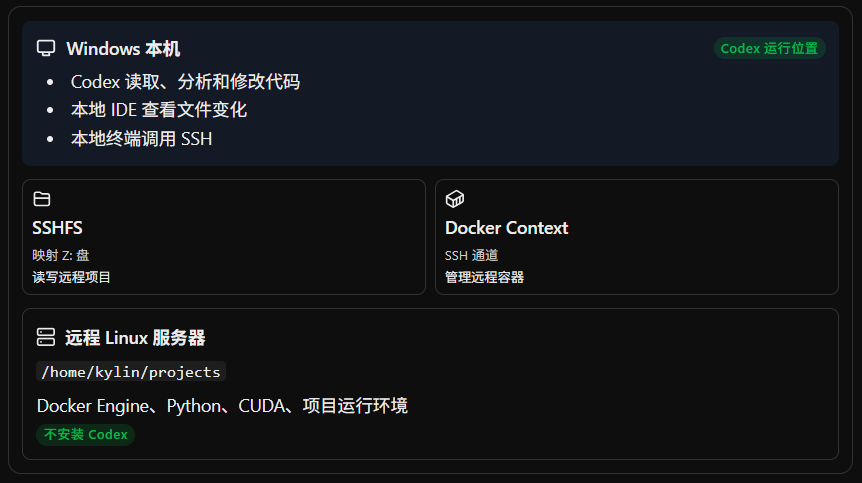

**Windows 本地 Codex + SSHFS 远程文件映射 + SSH 远程命令执行。**

让 **Windows 本机的 Codex 拥有远程服务器的文件访问能力和命令执行能力**。

>**起因**
>
>codex的vscode插件并不好用，并且也需要远程服务器安装codex，使用时服务器也要开启vpn，很麻烦甚至登录不了账号。还有服务器处于内网无法连外网的情况。

# **一、最终实现效果**

假设你的服务器信息如下（IP 和目录仅作示例）：

| 项目     | 配置                        |
| -------- | --------------------------- |
| 本机     | Windows 10                  |
| IDE      | Cursor 或 VS Code           |
| AI       | 本地 Codex                  |
| 远程系统 | 银河麒麟 V10 / Ubuntu 22.04 |
| SSH      | 192.168.0.24:22             |
| 远程用户 | kylin                       |
| 项目目录 | `/home/kylin/projects`      |
| Docker   | 远程 Docker Engine          |

配置完成后：

 

# **二、第一步：安装 SSHFS**

SSHFS-Win 通过 WinFsp 在 Windows 上提供远程文件系统映射。官方支持使用网络驱动器的方式映射远程目录。

**1. 安装 WinFsp**

官方地址：

[WinFsp 下载](https://winfsp.dev/rel/?utm_source=chatgpt.com)

下载并安装 Windows x64 版本。

**2. 安装 SSHFS-Win**

打开 PowerShell：

```
winget install SSHFS-Win.SSHFS-Win
```

如果 winget 安装失败，可以从官方仓库下载：

[SSHFS-Win Releases](https://github.com/winfsp/sshfs-win/releases?utm_source=chatgpt.com)

**3. 配置 SSH 免密登录**

Windows PowerShell：

```
ssh-keygen -t ed25519
```

将公钥复制到服务器：

```
type $env:USERPROFILE\.ssh\id_ed25519.pub
```

把输出内容追加到远程服务器：

```
~/.ssh/authorized_keys
```

测试：

```
ssh kylin@192.168.0.24
```

确保能够免密登录。

**4. 映射远程目录**

假设服务器项目位于：

```
/home/kylin/projects
```

执行：

```
net use Z: "\\sshfs.k\kylin@192.168.0.24\projects" /persistent:yes
```

这里的 `sshfs.k` 使用 SSH 密钥认证，`projects` 是相对于远程用户家目录的路径。

成功后，Windows 就会出现：

```
Z:\
├── xx
├── xx
├── xx
└── xx
```

可以像操作普通硬盘一样读写这些远程项目。

断开映射：

```
net use Z: /delete
```

# **三、第二步：配置 SSH 远程命令执行**

在 Windows 上配置 SSH 别名，后面 Codex 就不必每次输入 IP、用户名和端口。

编辑：

```
C:\Users\xxx\.ssh\config
```

添加：

```
Host kylin
    HostName 192.168.0.24
    User kylin
    Port 22
    IdentityFile C:/Users/Administrator/.ssh/id_ed25519
    IdentitiesOnly yes
```

测试：

```
ssh kylin "hostname"
ssh kylin "ls -lah /home/kylin/projects"
ssh kylin "python3 --version"
```

以后 Codex 可以直接通过本机终端执行这些命令。

例如你可以对 Codex 说：

> 通过 SSH 检查 kylin 服务器上的 Docker 容器，查看 ai-system 的日志，分析最近的启动错误。

Codex 可以在本地执行：

```
ssh kylin "docker ps -a"
ssh kylin "docker logs --tail 200 ai-system"
```

再读取返回结果进行分析。

# **四、第三步：连接远程 Docker**

这一步可以让本机 Docker CLI 直接管理服务器 Docker。

**1. Windows 安装 Docker CLI**

如果已经安装 Docker Desktop，可以直接使用其中的 Docker CLI。

**2. 创建远程 Docker Context**

```
docker context create kylin --docker "host=ssh://kylin"
```

**3. 测试远程连接**

```
docker --context kylin ps
```

查看容器：

```
docker --context kylin ps -a
```

查看日志：

```
docker --context kylin logs ai-system
```

进入容器：

```
docker --context kylin exec -it ai-system bash
```

重启容器：

```
docker --context kylin restart ai-system
```

Docker 官方支持通过 SSH 连接远程 Docker Engine，不需要开放 2375 端口。远程用户需要有访问 Docker Engine 的权限。


> 建议始终显式使用 `--context kylin`，避免误操作本机 Docker。

# **五、第四步：让 Codex 使用远程项目**

这是最关键的一步。

在 Windows 本地打开 Cursor 或 VS Code：

```
File → Open Folder
```

选择：

```
Z:\ai_system
```

此时：

- IDE 读取的是远程服务器上的文件。
- Codex 在 Windows 本机运行。
- Codex 修改文件，实际修改的是服务器上的文件。
- Codex 通过 SSH 命令执行远程操作。

例如给 Codex 下达任务：

```
分析当前项目的整体架构。

请检查：
1. Python 后端入口
2. Docker Compose 配置
3. MQTT 消息处理
4. 视频流处理模块
5. 数据库连接配置

如果发现问题，先给出分析，不要修改文件。
```

之后还可以让它：

```
修改当前项目的 Docker 部署配置，
通过 SSH 在 kylin 服务器执行构建，
启动容器并检查运行日志。
```

**权限提醒：** Codex 的 Windows 沙箱可能限制对映射盘和 SSH 网络连接的访问。如果出现拒绝访问，需要针对相应操作授权，而不是直接关闭全部沙箱保护。


# **六、特别注意：Codex 的 Windows 沙箱**

这里有一个需要提前测试的问题。

Codex 的 Windows MXC 沙箱对网络映射盘存在兼容性问题，已有报告显示，直接将映射盘作为工作区可能导致命令无法启动。

因此我建议先不要一次性迁移所有项目：

1. 先映射 Z 盘。
2. 用 VS Code 打开 Z 盘的测试项目。
3. 让 Codex 读取一个 Python 文件。
4. 让 Codex 修改一个测试文件。
5. 让 Codex 执行 `ssh kylin "hostname"`。
6. 再测试远程 Docker。

如果第 3～5 步遇到沙箱问题，我们再考虑把 Codex 命令执行放到本机 WSL2，而不是关闭所有安全限制。

另外，SSHFS-Win 的 `.k` 密钥模式默认使用 `id_rsa`，也支持通过 SSH config 指定其他密钥，但要求密钥没有口令保护。你之前生成的 `id_ed25519` 如果带有口令，需要额外调整认证方式。