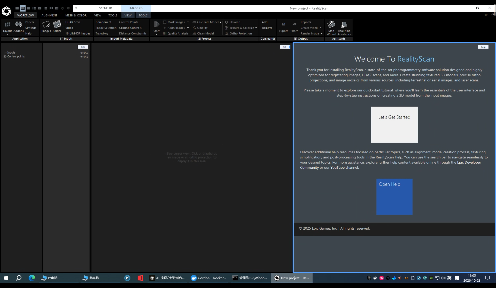
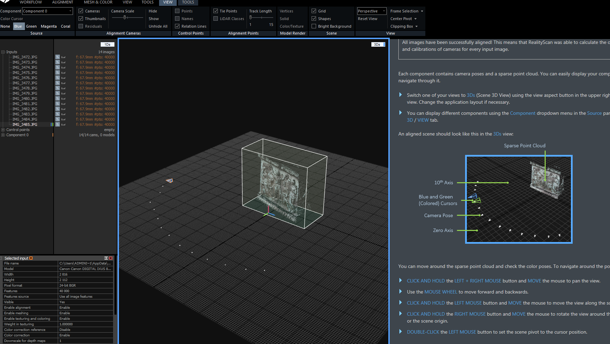
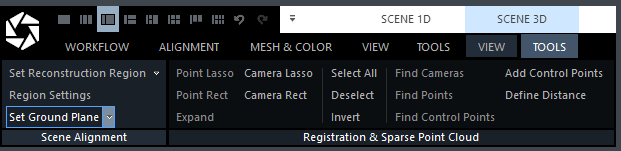
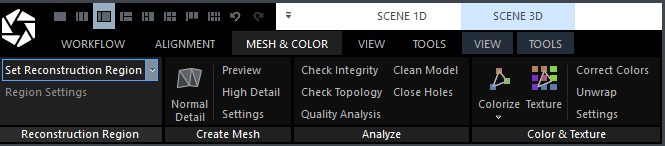
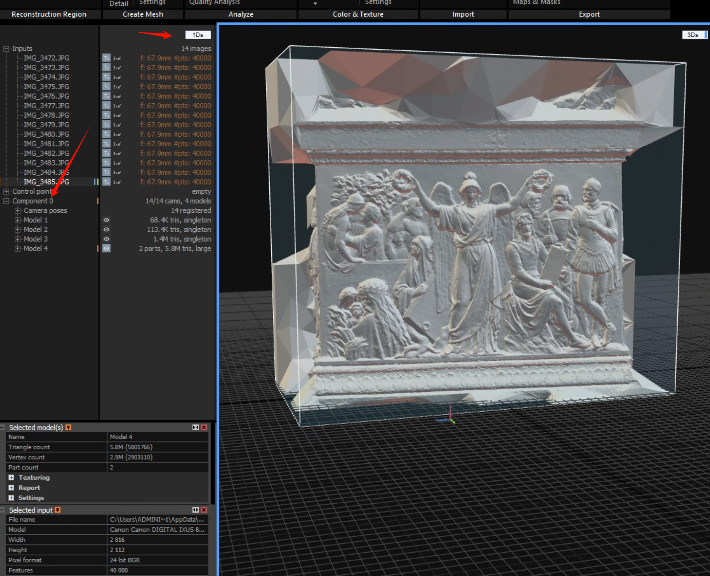
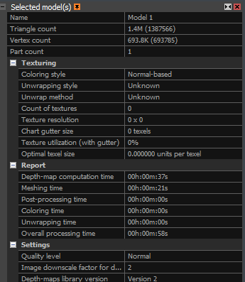
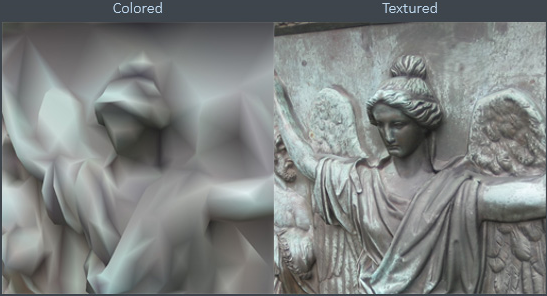

# 介绍

这是一款先进的摄影测量软件解决方案，经过专门设计和高度优化，可用于对图像、LiDAR（激光雷达）扫描数据等进行配准与处理。

借助 RealityScan，您可以创建精美的带纹理的三维模型、精确的正射投影成果以及图像镶嵌图。

它支持处理多种来源的数据，包括：

- 地面拍摄的图像：例如使用手机或相机拍摄的物体、建筑物或房间照片。
- 航空影像：例如无人机航拍照片。
- 激光扫描数据：例如 LiDAR 设备采集的点云数据。

# 关键术语解释

- Photogrammetry（摄影测量）：通过多张不同角度拍摄的照片，重建物体或场景的三维形状与纹理。
- Registering images（图像配准）：确定不同照片或扫描数据之间的位置、方向及空间对应关系。
- Textured 3D models（带纹理的三维模型）：不仅具有三维几何形状，还包含真实的颜色和表面细节。
- Ortho projections（正射投影）：消除透视和地形起伏等因素影响后生成的、具有准确空间比例的影像。
- Image mosaics（图像镶嵌图）：将多张重叠图像拼接成一幅完整的影像。

简单来说，RealityScan 可以将你用手机或相机拍摄的多张照片转换成真实感较强的三维模型，适用于物体建模、建筑物重建、室内场景重建等用途。

# 快速开始

## 添加图像（Add Images）

向项目中添加输入数据。可以使用自己的图像或 LiDAR（激光雷达）扫描数据，也可以使用下方的选项直接导入我们提供的数据集。

向项目添加输入数据有多种方式：

- 使用 Images（图像）按钮：在 Workflow（工作流）选项卡的 Inputs（输入）区域中，点击 Images 按钮，可以从同一个文件夹中添加一张或多张图像。也可以使用快捷键 `Ctrl + Enter`。
- 添加整个文件夹中的图像：点击 Folder（文件夹）按钮，或者使用快捷键 `Ctrl + Shift + Enter`，即可添加文件夹中的所有图像。
- 拖放导入：也可以直接将图像或其他输入数据拖放到 RealityScan 窗口中。当拖入的文件可以被接受时，鼠标指针附近会出现一个加号（+）标志。

## 查找图像

你可能想知道，已经添加到项目中的输入数据在哪里，以及如何查看它们。

在介绍如何查找输入数据之前，建议你先调整软件布局并打开更多视图。你随时可以按键盘上的 F1 键，返回帮助页面。

切换布局后，你就可以同时查看当前项目中已添加的图像列表、其中一张图像以及帮助页面。你也可以根据自己的喜好选择其他多视图布局。

### 设置布局

1. 选择 **Workflow（工作流）**选项卡。
2. 点击 Application（应用程序）区域的 **Layout（布局）**按钮。
3. 在弹出的下拉菜单中，选择 1+1+1 Layout（1+1+1 布局）。

1+1+1 布局将显示以下三个视图：

- 1Ds：显示图像列表。
- 2D：显示二维图像。
- Help：显示帮助页面。

每个视图的右上角都有一个视图类型按钮，用于指示当前视图的类型。

设置完成后，你应该可以在左侧看到所有图像的列表，中间看到当前选中的图像，同时保留帮助页面。

### 输入数据的导航技巧

#### 场景视图：1Ds 和 2Ds

- 点击左侧列表中的图像，即可切换当前选中的图像。
- 将图像拖放到任意视图中。
- 部分视图支持指定颜色光标。按住 `Ctrl` 键，同时按下数字键 `1`、`2`、`3` 或 `4`，即可为选中的图像分配四种颜色光标中的一种。
- 在 SCENE 1D 和 **SCENE 2D / VIEW（视图）**选项卡中，可以根据图像的不同属性进行排序。

#### 图像视图：2D

- 平移图像：按住鼠标左键并移动鼠标。
- 缩放图像：滚动鼠标滚轮，围绕鼠标指针所在位置进行缩放。
- 拖动图像：按住 `Ctrl` 键和鼠标左键，然后移动鼠标。
- 调整显示方式：打开 **IMAGE 2D / VIEW（视图）**选项卡，查看不同的图像显示选项。

---

这一节主要教你如何调整 RealityScan 的界面布局，以及如何查看、选择、平移和缩放已经导入的图像。设置好 `1+1+1 Layout` 后，你可以一边查看图像，一边阅读操作说明，方便后续进行图像对齐和三维重建。

## 对齐图像（Align Images）

图像对齐（Image Alignment），也称为图像配准（Image Registration），是指检测和匹配不同图像中共同的特征点（连接点），从而生成稀疏点云的过程。

在此过程中，软件会计算每张图像对应的以下参数：

- 相机位置（Camera Positions）：相机在三维空间中的位置。
- 相机方向（Camera Orientations）：相机在三维空间中的朝向。
- 相机内部参数（Internal Camera Parameters）：相机的内参，例如焦距和主点等。

完成图像对齐后，你就可以在 3Ds（三维场景）视图中查看这些图像。

### 如何切换视图类型

如果需要更改某个视图的类型，请按住该视图右上角的 Aspect（视图类型）按钮，然后将鼠标拖动到你想切换到的视图类型上。

### 如何执行图像对齐

方法一：使用按钮

在 **ALIGNMENT（对齐）**选项卡的 **Registration（配准）**区域中，点击 **Align Images（对齐图像）**按钮。

方法二：使用快捷键

直接按键盘上的 `F6` 键。

### 对齐需要多长时间？

处理时间取决于图像数量、分辨率和计算机性能。

例如，使用一台 2000 万像素相机拍摄的 100 张图像，通常只需要几分钟即可完成对齐。

## 组件与稀疏点云（Components and Sparse Point Cloud）

### 什么是组件（Component）？

组件是指一组能够成功对齐的图像。这些图像之间具有足够的重叠区域，并且包含一定数量的共同可识别特征。

如果图像无法成功对齐，最终可能会出现多个组件，也可能一个组件都没有。

这种情况可能由以下原因造成：

- 图像拍摄的是彼此不相连的场景。
- 图像模糊。
- 物体表面纹理不明显，缺少容易识别的特征。
- 图像数量不足。
- 不同图像之间的拍摄视角变化过大。

### 对齐失败：未创建组件

由于图像无法成功对齐，软件未能创建组件。

原因可能是图像之间缺少足够的重叠区域，或者没有足够的共同特征点。

请返回上一步，添加更多图像，然后重新执行对齐操作。

### 所有图像均已成功对齐

这意味着 RealityScan 已经成功计算出每张输入图像对应的相机方向和相机标定参数。

如果一组图像生成了多个组件，软件会提示：

检测到多个组件

根据输入图像计算出了多个组件。你可以选择以下操作：

- 添加更多图像，然后重新执行对齐。
- 使用控制点（Control Points）在不同图像之间创建人工连接点。
- 如果其中某个组件中已对齐的图像数量足以满足你的需求，可以直接进入下一步。

如果软件提示：

已创建组件，但并非所有输入都被使用

这表示部分图像没有成功参与对齐。你可以继续添加图像并重新对齐，也可以直接进入下一步。

你可以在 1Ds 视图中查看某个组件内成功对齐的输入数量。

### 组件包含哪些内容？

每个组件都包含：

- 相机位姿（Camera Poses）：每张图像对应的相机位置和朝向。
- 稀疏点云（Sparse Point Cloud）：通过图像匹配得到的一组稀疏三维特征点，用于表示场景的基本三维结构。

你可以显示不同的组件，并在三维场景中查看和浏览它们。

### 如何查看组件和稀疏点云？

1. 将任意一个视图切换为 3Ds（Scene 3D View，三维场景视图）。点击视图右上角的视图类型按钮进行切换。如果当前布局不合适，可以先调整应用程序布局。
2. 在 **SCENE 3D / VIEW（三维场景／视图）**选项卡的 **Source（来源）**区域中，使用 Component（组件）下拉菜单，选择要显示的组件。

完成对齐后的场景，在 3Ds 视图中应呈现类似示例图的效果。

### 如何在三维视图中导航？

| 操作                             | 功能                               |
| -------------------------------- | ---------------------------------- |
| 同时按住鼠标左键和右键并移动鼠标 | 平移视图                           |
| 滚动鼠标滚轮                     | 向前或向后移动视图                 |
| 按住鼠标左键并移动鼠标           | 沿场景网格移动视图                 |
| 按住鼠标右键并移动鼠标           | 围绕场景枢轴点或场景原点旋转视图   |
| 双击鼠标左键                     | 将场景枢轴点设置为鼠标光标所在位置 |

### 保存项目

请记得在每个处理步骤完成后保存项目。

保存方法：

- 点击软件左上角的 Logo 按钮，在弹出的下拉菜单中选择保存。
- 或者直接使用快捷键 `Ctrl + S`。

 

## 设置地平面（Set Ground Plane）

地平面用于定义点云的朝向。图像对齐完成后，RealityScan 会自动检测地平面。

不过，在某些情况下，自动检测的地平面可能存在倾斜，此时你可以手动调整其位置和方向。

这不是必需的操作，也不经常使用，但了解如何调整场景方向会很有帮助。

### 如何调整地平面？

1. 将任意一个视图切换为 3Ds（三维场景视图）。点击视图右上角的视图类型按钮。
2. 切换后，软件会显示 **SCENE 3D / TOOLS（三维场景／工具）**选项卡。
3. 打开该选项卡，点击 **Set Ground Plane（设置地平面）**按钮。
4. 此时，三维视图中会出现地平面操控工具，可以用它移动或旋转场景。

 

### 如何使用地平面操控工具？

- 旋转场景： 单击并拖动圆形操控柄。
- 沿指定轴移动场景： 按住鼠标左键，拖动箭头操控柄。场景会沿箭头所指的轴移动。
- 沿垂直于指定轴的平面移动场景： 按住鼠标右键，拖动箭头操控柄。
- 重新定位操控工具： 在场景中的任意位置双击鼠标。

### 如何重置地平面？

如果调整后想恢复初始设置：

1. 打开 **Set Ground Plane（设置地平面）**下拉菜单。
2. 点击 Reset Ground（重置地面）。

此外，你还可以使用同一下拉菜单中的 Set Ground by Reconstruction Region（根据重建区域设置地面），将地平面设置为现有重建区域所对应的地面。

## 调整重建区域（Adjust Reconstruction Region）

图像对齐完成后，RealityScan 会自动设置重建区域，其大小取决于稀疏点云的范围。

**重建区域（Reconstruction Region）**用于限制三维模型的重建范围。你可以移动、旋转或调整该区域的大小，从而只重建场景中的特定部分。

你也可以移除重建区域，对整个场景进行重建。不过，通常建议保留并合理设置重建区域，以减少不必要的计算，加快模型生成速度。

### 如何调整重建区域？

本节属于快速入门指南，不会详细介绍设置重建区域的所有方法，但会介绍如何移动和旋转重建区域。

你可以通过以下任意一种方式激活重建区域操控工具：

1. 打开 **MESH & COLOR（网格与颜色）**选项卡，找到 **Reconstruction Region（重建区域）**区域中的相关按钮。
2. 或者打开 **SCENE 3D / TOOLS（三维场景／工具）**选项卡，在 **Scene Alignment（场景对齐）**区域中找到重建区域按钮。
3. 点击相应按钮，激活重建区域操控工具。
4. 你也可以直接在 3Ds（三维场景）视图中点击重建区域的任意一条边，激活该工具。

该操控工具的使用方式与设置地平面的操控工具类似。

 

### 如何使用重建区域操控工具？

- 旋转重建区域： 单击并拖动四分之一圆形操控柄。
- 沿指定轴移动区域： 按住鼠标左键，拖动箭头操控柄，区域会沿箭头所指的轴移动。
- 沿垂直于指定轴的平面移动区域： 按住鼠标右键，拖动箭头操控柄。
- 调整区域大小： 单击并拖动重建区域外侧的圆形操控柄。

### 举例说明

假设你拍摄了一整个房间，但只需要重建房间中央的设备区域：

- 将重建区域缩小到设备及其周围的范围。
- 调整区域的位置，使设备完整地包含在区域内。
- 必要时旋转区域，使其与场景方向一致。
- 后续重建时，软件就可以减少对无关区域的处理。

这样可以节省计算资源和处理时间。

注意： 重建区域主要决定模型计算的空间范围，并不会自动提高点云质量，也不会修复错误的图像对齐。

## 计算模型（Compute a Model）

你已经完成图像对齐并调整了重建区域，现在可以开始创建三维模型了。

RealityScan 支持不同细节级别的模型重建：预览（Preview）、普通细节（Normal Detail）和高细节（High Detail）。

普通细节和高细节重建需要更多计算资源，对硬件性能的要求也更高，因此耗时更长。最终生成的结果包含非常密集的网格和点云。

这里的点云与图像对齐后生成的稀疏点云不同。它是由三维网格的顶点构成的，因此能够更密集地表示物体表面。

### 如何计算模型？

1. 打开 **MESH & COLOR（网格与颜色）**选项卡。
2. 找到 **Create Mesh（创建网格）**区域。
3. 选择相应的重建按钮，启动模型计算。
4. 等待重建完成。

RealityScan 最常用的是 **Normal Detail（普通细节）**模式。你也可以尝试 Preview（预览）和 High Detail（高细节）模式，对比不同级别的重建效果。

### 三种重建级别的区别

| 模式                      | 特点                           | 适用场景                 |
| ------------------------- | ------------------------------ | ------------------------ |
| Preview（预览）           | 计算较快，细节较少             | 快速检查重建效果         |
| Normal Detail（普通细节） | 细节与计算成本较均衡           | 常规三维建模             |
| High Detail（高细节）     | 计算量更大，通常能保留更多细节 | 对精细程度要求较高的场景 |

实际效果还取决于照片数量、清晰度、纹理质量及计算机硬件性能。

### 模型生成后在哪里查看？

重建完成后，你可以在 1Ds 视图中找到生成的模型。模型会显示在用于创建它的组件下面。

 

## 检查你的模型（Inspect Your Model）

你已经成功创建了一个三维模型，现在可以在 3Ds（三维场景）视图中查看它。

如果当前没有打开 3Ds 视图，可以点击任意视图右上角的视图类型按钮，将其切换为 3Ds 视图。

### 如何在三维视图中浏览模型？

浏览模型的操作方式与浏览组件时相同。为了方便你直接参考，这里再次介绍操作方法：

- 平移视图： 同时按住鼠标左键和右键，然后移动鼠标。
- 前后移动视图： 滚动鼠标滚轮。
- 沿场景网格移动视图： 按住鼠标左键并移动鼠标。
- 旋转视图： 按住鼠标右键并移动鼠标，围绕场景枢轴点或场景原点旋转。
- 设置场景枢轴点： 在场景中的目标位置双击鼠标左键。

### 模型统计信息（Model Statistics）

选择一个模型，即可打开 **Selected model(s)（选中模型）**面板，查看该模型的详细信息。

这个面板位于 1Ds 视图左侧。实际上，你也可以选择 1Ds 视图中列出的其他元素，例如图像或组件，查看相应的信息。

选中模型后，模型信息面板会显示在场景树视图下方。

你可以在这里查看和修改以下内容：

- 模型尺寸： 查看模型的大小。
- 使用的设置： 查看生成模型时使用的重建参数。
- 纹理信息： 查看模型的纹理相关信息。
- 时间信息： 查看与模型处理相关的时间记录。
- 模型名称： 修改模型名称，方便整理和管理项目。

 

### 当前模型的显示状态

目前，你的模型还没有颜色，显示为平面着色的网格（Flat-shaded Mesh），并使用四方向动态光照进行显示。

这并不代表模型重建失败，而是因为尚未完成后续的着色或纹理处理。

## 为模型着色（Colorize Your Model）

### 颜色与纹理有什么区别？

- Colorize（着色）： 为模型表面赋予颜色，让模型不再只是单一的灰色网格。
- Texture（纹理）： 将照片中的颜色和表面细节投射到模型表面，生成更真实的视觉效果。

目前，你的模型是一个没有颜色的平面着色网格。保持这种显示方式，有助于发现网格中的裂缝和其他问题。

如果要为模型添加颜色，请打开 **MESH & COLOR（网格与颜色）**选项卡，在 **Color & Texture（颜色与纹理）**区域中使用 `Colorize（着色）` 或 `Texture（纹理）`按钮。

具体选择哪种方式，取决于你的实际需求。

### 一、彩色模型（Colored Model）

这种方式特别适合非常密集的三维模型，因为在这类模型中，添加纹理不一定能明显改善视觉效果。

它的工作原理是：

1. 将颜色赋予三维网格的顶点。
2. 根据顶点的颜色，对顶点之间的多边形进行颜色插值。
3. 最终得到带有颜色的三维模型。

与纹理贴图相比，这种方式无法呈现同等精细程度的表面细节。

因此，它适用于以下场景：

- 快速预览彩色模型。
- 模型已经具有非常密集的几何结构。
- 对颜色细节要求不高的应用场景。

### 二、带纹理的模型（Textured Model）

纹理处理更为常用，因为它适用于许多不同的行业，并且通常能够提供更高的视觉细节质量。

它的工作原理是：

1. 计算一张或多张图像，用于覆盖模型的所有多边形，并包含对应的颜色信息。
2. 将这些图像应用到模型的 **UV 映射（UV Maps）**上。
3. 最终生成具有真实表面颜色和细节的三维模型。

UV 映射是三维物体表面在二维平面上的表示方式，可以理解为将三维模型的表面展开成二维图案，以便把照片中的颜色和细节准确地映射回模型表面。

在生成纹理之前，你可以先展开模型并创建 UV 映射；也可以直接使用 `Texture` 工具，在生成纹理的同时完成这些操作。

如果已经展开了模型，之后需要使用 **Unwrap（展开）**工具来创建新的 UV 映射。

### 三、两种方式的区别

| 对比项目     | Colorize（着色）   | Texture（纹理）          |
| ------------ | ------------------ | ------------------------ |
| 颜色存储方式 | 网格顶点颜色       | 二维纹理贴图             |
| 表面细节     | 相对有限           | 通常更丰富               |
| 额外数据     | 主要是顶点颜色     | 需要纹理图像和 UV 映射   |
| 适用场景     | 快速预览、简单着色 | 高真实感模型、精细外观   |
| 处理重点     | 为顶点赋色         | 将图像细节映射到模型表面 |

 

## 导出模型（Export a Model）

你已经成功创建了模型并为其添加了颜色，现在可以导出模型了。

进入 MESH & COLOR（网格与颜色） 选项卡，在 Export（导出） 区域中点击 Model & Point Cloud（模型与点云） 按钮。

这将打开 Windows 文件资源管理器窗口，你可以在其中设置模型名称、选择导出位置以及导出格式。

点击 Save（保存） 后，将进入下一步，即 Export Model（导出模型） 对话框，在这里设置导出参数。

注意： 在 Windows 文件资源管理器窗口中设置的名称、路径和格式，进入后续导出设置界面后将无法更改，因此请谨慎选择。

你也可以通过以下两种方式导出模型：

- 在 SCENE 3D / TOOLS（3D 场景 / 工具） 选项卡的 Export（导出） 区域中，点击 Model & Point Cloud。
- 在 WORKFLOW（工作流） 选项卡的 Output（输出） 区域中，点击通用的 Export（导出） 按钮。

重要：导出模型前，不一定要进行着色或添加纹理。 你可以在完成模型重建后，立即导出模型。

## 视频作为输入（Video as an Input）

如果你拍摄的视频方式类似于摄影测量中拍摄照片的方式，那么你可以使用视频代替照片和/或激光雷达扫描数据，也可以将视频作为补充输入，与其他拍摄同一物体或场景的项目数据一起使用。

你可以根据需要添加任意数量的视频。

（你甚至可以利用此功能将任意视频切分成一系列图片，而不一定要将这些图片用于本软件中的三维重建。）

RealityScan 会从视频中提取关键帧，也就是定义平滑运动转换起点和终点的帧，并忽略由视频编解码器生成的插值帧，因为这些帧在几何精度上可能存在偏差。软件会尽可能自动完成这一过程，以帮助你获得理想的重建结果。

在不额外安装编解码器、仅使用 Windows 系统自带编解码器的情况下，你可以导入以下视频格式：

- Advanced Systems Format（`.asf`）
- AVI（`.avi`）
- QuickTime（`.mov`）
- MPEG（`.mpg`、`.mpeg`、`.mp4`）
- Windows Media Video（`.wmv`）

提取后的视频帧将保存为 PNG 格式。

### 操作步骤（Procedure）

1. 导入视频

在 `WORKFLOW`（工作流）选项卡中点击 `Video`（视频）按钮，或者直接将一个或多个视频文件拖放到 RealityScan 项目中。

2. 设置视频提取参数

选择视频后，软件会打开设置对话框。你需要指定提取帧的保存位置，以及提取帧之间的时间间隔，即 `Jumps' length(s)`（跳帧间隔）。

3. 提取并导入图像

点击 `Import`（导入）后，软件会将视频拆分为图像帧，并将其加载到应用程序中。

你可以在 `1Ds` 面板的 `Images`（图像）根目录下找到这些图像。

4. 继续处理项目

   此时，你可以继续添加其他输入数据，也可以直接对已导入的数据进行对齐，并按照常规流程开展后续处理。

### 结合你的实际使用场景

如果你想使用手机拍摄房间或建筑物，再通过 RealityScan 重建三维场景，那么可以直接导入手机拍摄的视频，不一定非要逐张拍照。

不过需要注意：

- 视频提取的帧不一定越多越好：相邻帧画面过于相似，通常无法提供足够的额外几何信息。
- 拍摄时应保持场景清晰：尽量避免快速移动、运动模糊和剧烈曝光变化。

## 如何拍摄照片（How to Take Photographs）

使用照片创建三维模型既有趣又简单。不过，如果你希望获得高质量的重建结果，就需要遵循一些拍摄规则。这并不复杂，按照这些规则操作，可以减少甚至避免后续大量的手动修复工作。

### 一、通用规则（General Rules）

为了让 RealityScan 获得更好的重建效果，并尽可能提高处理效率，请记住以下几点：

1. 照片数量不要过于受限。 RealityScan 可以处理大量照片。
2. 尽可能使用最高分辨率。 高分辨率照片有助于保留更多细节。
3. 确保场景表面的每个点，至少能在两张高质量照片中清晰看到。 通常，覆盖越充分，重建效果越好。
4. 拍照时要不断移动位置。 一直站在同一个位置拍摄，只能得到类似全景照片的效果，无法为三维模型重建提供足够的视角信息。应围绕物体移动拍摄。
5. 相邻拍摄位置的视角变化不要超过 30°。 避免相邻照片之间的视角跨度过大。
6. 遵循由整体到细节的原则。 先拍摄整个物体，围绕物体移动一圈，然后再逐渐靠近拍摄细节。不要突然从远处跳到极近距离，应逐步靠近。
7. 尽量完成完整的一圈拍摄。 对于雕像、建筑物等物体，应围绕目标持续拍摄，最后回到起始位置附近，形成完整的拍摄环路。

### 二、细节级别与精度（Level of Detail and Precision）

RealityScan 可以生成精度很高的三维模型，甚至达到亚毫米级分辨率。

我的三维模型最终能达到什么分辨率？

这取决于以下因素：

- 照片的质量和分辨率。
- 拍摄时相机与物体之间的距离。

