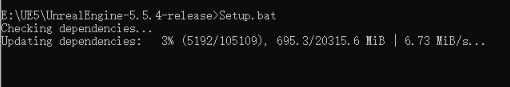
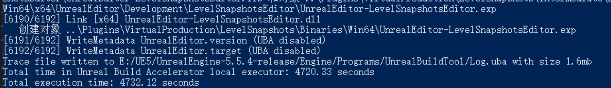
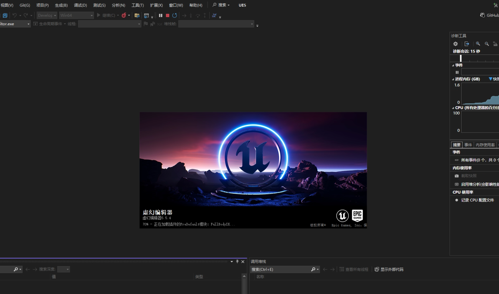

---
title: "UE5源码下载及编译"
date: 2026-10-13
lastmod: 2026-10-13
draft: false
tags: ["UE5", "Unreal Engine", "源码", "Visual Studio", "编译", "GitHub"]
categories: ["技术", "教程"]
---

完整教程：https://dev.epicgames.com/documentation/unreal-engine/downloading-source-code-in-unreal-engine

1.首先按照[教程](https://www.unrealengine.com/ue-on-github/)把github账户和EIPC账户进行绑定

2.然后在邮件中确认加入

3.

 

4.加入后就能访问https://github.com/EpicGames/UnrealEngine，否则显示的是空网页

5.准备好**Visual Studio**

6.打开源代码文件夹，并运行`Setup.bat`。

这样将下载引擎的二进制内容和先决程序，并设置虚幻文件关联。 在Windows上，可能会显示SmartScreen警告。 请点击**更多信息（More info）**和**依然运行（Run anyway）**以继续。

引擎二进制文件的完整下载包需要一些时间才能完成下载。 后续检出只需要下载增量部分，速度将会大幅提高。



7.等待 `Setup.bat` 成功完成后，在同一目录运行：

```
GenerateProjectFiles.bat
```

正常完成后，根目录中应该生成：

```
UE5.sln
```

Epic 官方说明：这个步骤会生成供 Visual Studio 使用的解决方案文件。 

8.编译引擎

双击 `UE5.sln`，在 Visual Studio 顶部选择：

Configuration（配置）：Development Editor

Platform（平台）：Win64

在解决方案资源管理器中找到 UE5 项目，右键选择“生成（Build）”。首次完整编译可能需要数十分钟至数小时，具体取决于硬件和依赖是否齐全。(注意剩余磁盘空间要预留充足，我留了100GB都不够)

 

9.编译成功后，在解决方案资源管理器项目列表中找到 `UE5` 项目，右键点击 `UE5`，选择 设为启动项目（Set as Startup Project）。并按**F5**进行调试，通过“调试 → 启动新实例”运行编辑器。

 

