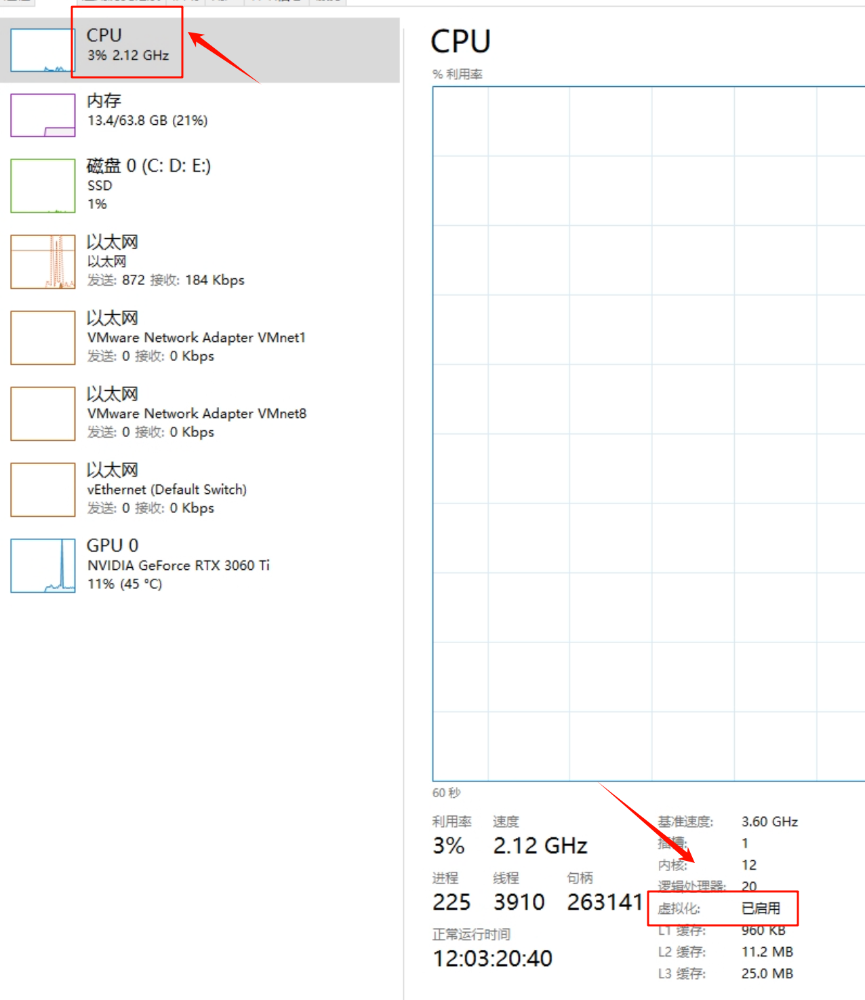

目标：**WSL2 + Ubuntu 24.04 LTS**

## **一、检查 Windows 版本**

按 `Win + R`，输入：

```
winver
```

建议：

- Windows 11：推荐。
- Windows 10：建议 22H2，并确保已安装支持 WSL2 的更新。

还需要在 BIOS 中开启 CPU 虚拟化：

- Intel：Intel VT-x
- AMD：AMD-V / SVM

> 可以在任务管理器中查看是否开启了虚拟化
>  

## **二、开启 WSL2**

推荐使用管理员 PowerShell

1. 右键点击 Windows 开始菜单。
2. 选择「终端（管理员）」或「Windows PowerShell（管理员）」。
3. 执行：

```
wsl --install
```

这条命令会安装 WSL 所需组件，并通常安装默认 Ubuntu 发行版（默认2026版的，如果不需要就跳过）。

如果提示需要重启，先重启 Windows。

## **三、安装指定版本 Ubuntu 24.04**

重启后，再次打开管理员 PowerShell。

先查看可安装的 Linux 发行版：

```
wsl --list --online
```

找到：

```
Ubuntu-24.04    Ubuntu 24.04 LTS
```

然后执行：

```
wsl --install -d Ubuntu-24.04
```

如果 Microsoft Store 下载遇到问题，可以尝试：

```
wsl --install -d Ubuntu-24.04 --web-download
```

这会安装指定的 Ubuntu 24.04，而不是不确定版本的默认 Ubuntu。


## **四、初始化 Ubuntu**

安装完成后，Ubuntu 会自动启动，第一次启动需要等待初始化。

它会要求创建 Linux 用户：

```
Enter new UNIX username:
```

例如：

```
user
```

然后设置密码：

```
New password:
Retype new password:
```

注意：Linux 输入密码时不会显示星号，这是正常现象。

## **五、设置 WSL2 为默认版本**

回到 PowerShell，执行：

```
wsl --set-default-version 2
```

再查看已安装系统：

```
wsl -l -v
```

预期结果：

```
  NAME            STATE       VERSION
* Ubuntu-24.04    Running     2
```

如果显示 VERSION 为 1，执行：

```
wsl --set-version Ubuntu-24.04 2
```

然后设置默认发行版：

```
wsl --set-default Ubuntu-24.04
```

## **六、更新 Ubuntu 系统**

首先更改为中国的源

使用的是 **Ubuntu 24.04 LTS（WSL2）**，推荐配置清华大学镜像源，安全更新仍保留 Ubuntu 官方源。

Ubuntu 24.04 使用新的 `.sources` 配置格式，文件位置是：

`/etc/apt/sources.list.d/ubuntu.sources`。

### **1. 备份原配置**

在 Ubuntu 终端执行：

```
sudo cp /etc/apt/sources.list.d/ubuntu.sources \
/etc/apt/sources.list.d/ubuntu.sources.bak
```

### **2. 配置清华源**

直接复制执行下面整段命令：

```
sudo tee /etc/apt/sources.list.d/ubuntu.sources > /dev/null <<'EOF'
Types: deb
URIs: https://mirrors.tuna.tsinghua.edu.cn/ubuntu
Suites: noble noble-updates noble-backports
Components: main restricted universe multiverse
Signed-By: /usr/share/keyrings/ubuntu-archive-keyring.gpg

Types: deb
URIs: http://security.ubuntu.com/ubuntu/
Suites: noble-security
Components: main restricted universe multiverse
Signed-By: /usr/share/keyrings/ubuntu-archive-keyring.gpg
EOF
```

### **3. 更新软件包索引**

```
sudo apt clean
sudo apt update
```

### **4. 验证配置**

```
cat /etc/apt/sources.list.d/ubuntu.sources
```

应该看到：

- `mirrors.tuna.tsinghua.edu.cn`：清华大学镜像源
- `security.ubuntu.com`：官方安全更新源
- `noble`：Ubuntu 24.04 代号

---

接着进入 Ubuntu，执行：

```
sudo apt update
sudo apt upgrade -y
```

安装常用开发工具：

```
sudo apt install -y \
    build-essential \
    git \
    wget \
    curl \
    vim \
    unzip \
    python3 \
    python3-pip \
    python3-venv
```

检查 Ubuntu 版本：

```
lsb_release -a
```

应该看到：

```
Description: Ubuntu 24.04 LTS
Codename: noble
```

## **七、验证 WSL2 和 GPU**

先在 PowerShell 执行：

```
wsl --update
wsl --status
wsl -l -v
```

然后在 Ubuntu 执行：

```
uname -r
nvidia-smi
```

如果 `nvidia-smi` 能显示 NVIDIA 显卡信息，说明 WSL 的 GPU 接口已经可以使用。

> 重要
>
> NVIDIA 显卡驱动安装在 Windows 宿主机，不要在 Ubuntu WSL 中再安装完整的 Linux NVIDIA 驱动。


## 八、wsl迁移到其他盘

假设你希望存放在D 盘：

```
D:\WSL\Ubuntu-24.04
```

先关闭 WSL：

```
wsl --shutdown
```

创建父目录：

```
New-Item -ItemType Directory -Force -Path "D:\WSL"
```

执行迁移：

```
wsl --manage Ubuntu-24.04 --move "D:\WSL\Ubuntu-24.04"
```

等待迁移完成，不要中途关闭终端或电脑。

**确认迁移成功**

执行：

```
wsl -d Ubuntu-24.04
```

进入 Ubuntu 后：

```
lsb_release -a
whoami
df -h /
```

然后回到 PowerShell，查询新的注册路径：

```
Get-ChildItem "HKCU:\Software\Microsoft\Windows\CurrentVersion\Lxss" |
ForEach-Object {
    Get-ItemProperty $_.PSPath |
    Select-Object DistributionName, BasePath
}
```

预期 Ubuntu 的路径变成：

```
D:\WSL\Ubuntu-24.04
```

虚拟磁盘通常就是：

```
D:\WSL\Ubuntu-24.04\ext4.vhdx
```