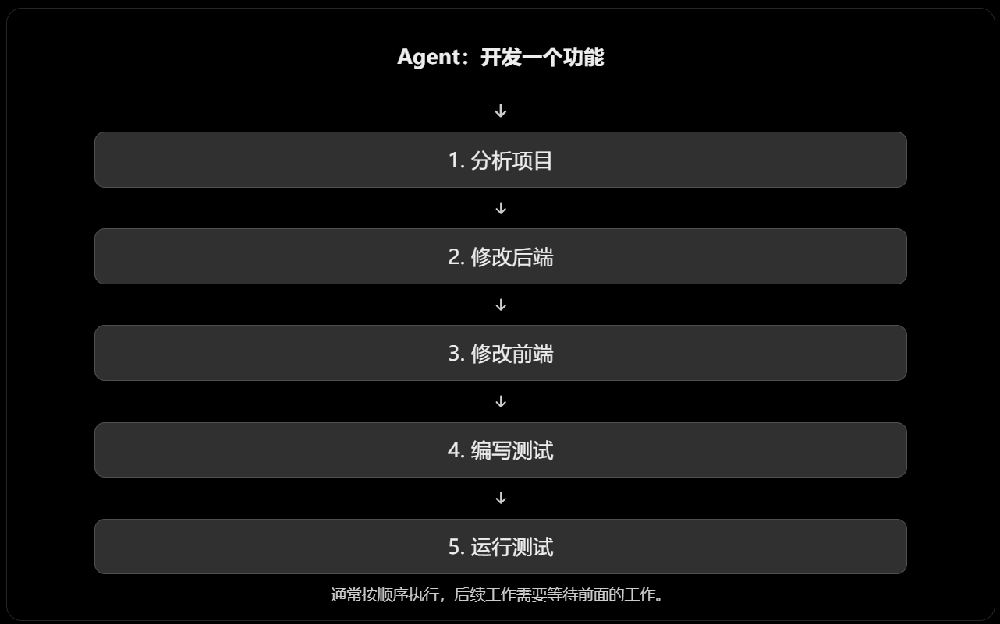
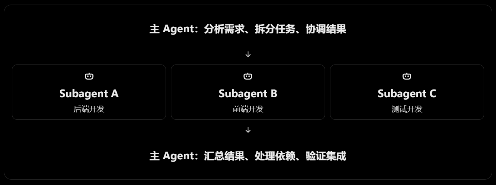
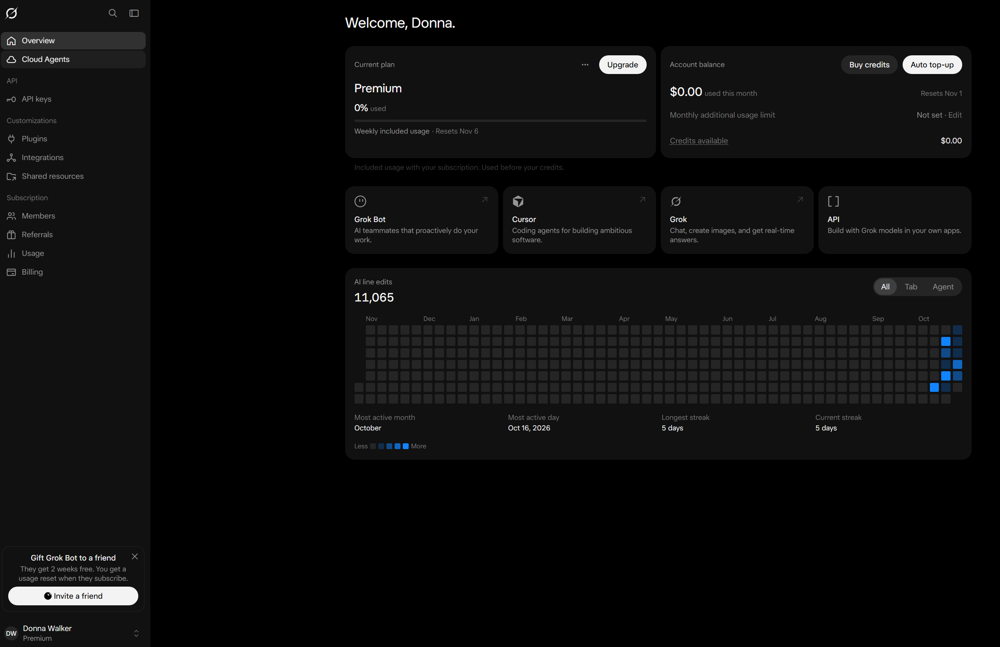
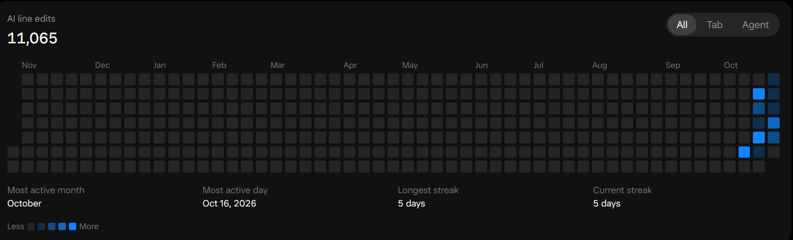
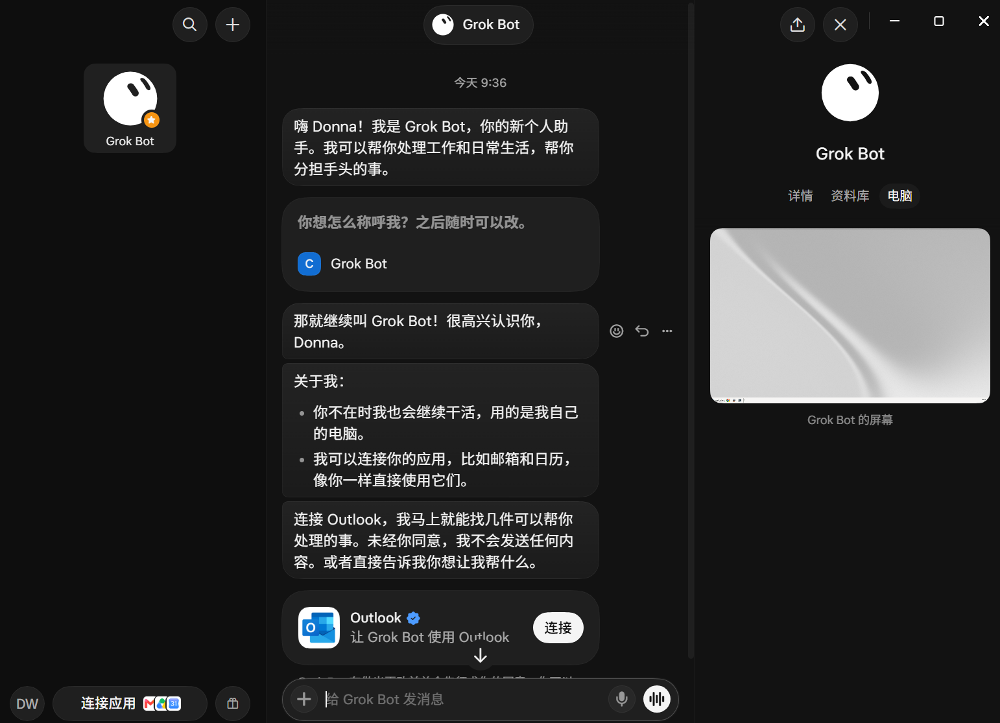

cursor更新资费了，买了个会员，但是还是只会使用Agent，其他很多功能都没涉及，感觉很亏。现在详细的学习一个可以用到的功能。

# 快速入门

## Cursor 编辑器到底能做什么？

Cursor 并不只是一个可以聊天的 AI，它实际上是一个带有 AI Agent 能力的代码编辑器。

它能够直接操作你的工程项目。

传统开发方式：

1. 自己查找代码文件。
2. 自己阅读代码。
3. 自己修改代码。
4. 自己执行程序。
5. 自己排查错误。

Cursor 的方式：

1. 告诉 AI 你想实现什么。
2. AI 自己阅读项目。
3. AI 找到相关文件。
4. AI 修改多个文件。
5. AI 执行命令、测试程序。
6. AI 根据运行结果继续修复。

## 最重要的四种使用模式

Cursor 的 Agent 面板提供不同的工作模式。不同版本界面可能略有区别。

### 1.Ask：提问模式

（新手首选）

只读取和分析代码，不主动修改项目。

适合：

- 阅读陌生项目。
- 分析代码执行流程。
- 解释某个 Python 函数。
- 排查潜在问题。

### 2.Agent：智能代理模式

（最常用）

能够自主搜索、修改多个文件、执行终端命令和测试。

适合：

- 开发一个新功能。
- 修改 YOLO 推理逻辑。
- 增加 MQTT 报警。
- 修复程序 Bug。
- 重构项目架构。

### 3.Plan：规划模式

先让 AI 阅读项目、制定实施方案，再由你确认后执行。

适合：

- 大型项目开发。
- 修改多个模块。
- 数据库结构调整。
- 系统架构重构。

建议涉及多个文件时先用 Plan。

4. Debug：调试模式

针对复杂错误进行调查，利用代码、运行结果和日志寻找原因。

适合：

- Python 程序崩溃。
- CUDA 报错。
- 内存泄漏。
- YOLO 推理异常。
- 服务运行一段时间后卡死。

模式名称和可用功能会随 Cursor 版本及订阅调整。

### 5.Multitask多任务

Cursor 现在增加了 Multitask（多任务）能力，它不是简单地多开几个聊天窗口，而是可以让 Agent 把一个任务拆分成多个子任务，由多个异步 Subagents 并行处理。

Cursor 官方在 2026 年 4 月 24 日发布了这项功能。


普通 Agent 的工作方式：

 

通常按顺序执行，后续工作需要等待前面的工作。

Multitask 的工作方式：

 

最大的区别：

- 普通 Agent：一个 AI 依次完成多个工作。
- Multitask：多个 AI 同时处理相互独立的工作。
- 主 Agent：负责拆分任务和汇总结果。

需要注意，并不是所有任务都能并行。如果两个子任务都要修改同一个文件，就可能出现冲突。


## 最重要的快捷键

| 快捷键             | 功能                   | 用途                   |
| ------------------ | ---------------------- | ---------------------- |
| `Ctrl + I`         | 打开 Agent 面板        | 与 AI 对话             |
| `Ctrl + L`         | 将选中代码发送给 Agent | 定向分析代码           |
| `Ctrl + K`         | 选中代码后进行编辑     | 局部修改（旧版工作流） |
| `Tab`              | 接受 AI 代码补全       | 快速写代码             |
| `Ctrl + Shift + P` | 打开命令面板           | 搜索编辑器命令         |
| `Ctrl + E`         | 后台 Agent 入口        | 云端执行任务           |


## 从零开始：第一次使用 Cursor

建议你不要一开始就让 Cursor 开发一个完整系统。先拿一个已经存在的  项目练习。

### 第一步：打开已有项目

在 Windows 中：

1. 启动 Cursor 编辑器。
2. 点击 `File` → `Open Folder`。
3. 选择你的项目目录，

点击打开。

等待 Cursor 加载项目。

打开后，左侧会显示项目文件树。

> 重要： 第一次打开项目，建议先使用 Git 建立备份，或者复制一份项目。这样即使 AI 修改错了，也能恢复。

### 第二步：让 AI 阅读整个项目

按 `Ctrl + I` 打开 Agent 面板。

切换到 Ask 模式，输入：

请完整阅读当前项目，分析项目的整体架构。

AI 会开始搜索项目中的文件。

你可以看到它：

- 读取了哪些文件。
- 搜索了哪些函数。
- 分析了哪些模块。
- 最终生成的项目说明。

这样你就不必把整个项目的代码复制到聊天窗口里。

### 第三步：让 AI 修改代码

切换到 Agent 模式，输入要求

先检查项目架构，必要时先制定实施方案，再执行修改。

这时 Cursor 就可以：

- 自动定位检测代码。
- 自动找到模块。
- 修改相关文件。
- 修改配置文件。
- 执行测试。

你不需要自己逐个打开文件。

### 第四步：检查 AI 修改的代码

这是非常重要的一步。

Cursor 会展示代码修改差异（Diff）。

通常：

- 绿色：新增代码。
- 红色：删除代码。
- 普通区域：未修改代码。

你应该检查：

1. 是否修改了不相关的文件？
2. 有没有删除原有功能？
3. 有没有引入新的依赖？
4. 配置文件是否兼容原来的配置？
5. 测试是否真正通过？

如果不满意，可以拒绝相应修改，或者使用 Agent 对话中的 Restore Checkpoint 恢复之前的文件状态。

不要让 AI 修改完代码后，不经过检查就直接部署到生产服务器。 


## Cursor 的几个高级功能

这些才是会员比较值得利用的功能。

### 1. Tab：智能代码补全

你在编辑器中输入代码时，Cursor 会根据上下文自动预测后续代码。

例如：

```
def calculate_distance(p1, p2):
```

Cursor 可能自动补充：

```
    return ((p1[0] - p2[0]) ** 2 +            (p1[1] - p2[1]) ** 2) ** 0.5
```

按 `Tab` 接受建议，不需要就继续输入或忽略。

适合日常开发，不需要每次都打开 Agent。

### 2. Rules：给 AI 设定长期开发规范

例如，你经常使用：

- Python 3.10。
- PyTorch。
- Ultralytics YOLO。
- Ubuntu 24.04。
- MQTT。
- Vue。

你可以给项目配置规则，让 AI 每次开发都遵守这些约束。

例如在项目中创建：

```
.cursor/
    rules/
        project.mdc
```

内容示例：

```
---
description: YOLO项目开发规范
alwaysApply: true
---

# 项目开发规范

- 使用 Python 3.10。
- 保持现有项目架构。
- 优先复用已有代码。
- 不要随意修改配置文件格式。
- 不要擅自升级 PyTorch、CUDA 或 Ultralytics。
- GPU 推理需要考虑显存占用。
- 视频处理需要考虑线程安全。
- 长时间运行的服务需要考虑资源释放。
- 所有新增功能都需要提供日志。
- 修改完成后执行相关测试。
- 不要未经确认删除现有功能。
```

以后在这个项目中使用 Agent，它就能自动参考这些规则。

这可以明显减少反复解释项目背景的时间。

### 3. MCP：让 Cursor 连接外部工具

MCP 可以理解为给 AI 增加外部工具接口。

例如：

MCP 可以连接的工具

数据库：查询数据

GitHub：代码仓库

浏览器：网页操作

文件系统：文件操作

自定义服务：业务接口

例如，你可以配置数据库 MCP，让 Cursor 查询你的业务数据库。

然后告诉它：

> 分析数据库中的设备表和报警表，找出最近一周出现频率最高的设备报警类型。

它可以通过配置好的数据库工具执行查询。

注意：MCP 不是自动获得所有系统权限，具体能力取决于连接的工具及其授权。

### 4. Cloud Agents：云端 AI 代理

它与本地 Agent 的主要区别：

| 对比             | 本地 Agent | Cloud Agent              |
| ---------------- | ---------- | ------------------------ |
| 运行环境         | 你的电脑   | 云端环境                 |
| 操作项目         | 本地项目   | 云端工作副本             |
| 执行命令         | 本地终端   | 云端终端                 |
| 是否占用本机资源 | 会         | 通常不会占用本机计算资源 |
| 适合任务         | 日常开发   | 独立任务、后台开发       |

例如：

你正在本地开发系统，可以同时让 Cloud Agent：

- 分析另一个项目。
- 为某个模块增加单元测试。
- 重构一段独立代码。
- 调查某个 Bug。

完成后再检查它的修改，并合并回自己的工程。

注意云端环境不等于自动拥有你本地的文件，需要配置或提供代码仓库访问。


# 官方学习资料

下面这些建议收藏：

| 学习内容       | 官方资料                                                     |
| -------------- | ------------------------------------------------------------ |
| 快速入门       | [Cursor Quickstart](https://docs.cursor.com/en/get-started/quickstart?utm_source=chatgpt.com) |
| Agent 使用     | [Agent Mode](https://prod.cursor.com/help/ai-features/agent?utm_source=chatgpt.com) |
| Agent 工作原理 | [Agent Overview](https://docs.cursor.com/en/agent/overview?utm_source=chatgpt.com) |
| 云端 Agent     | [Background Agents](https://docs.cursor.com/background-agent?utm_source=chatgpt.com) |
| 模型和价格     | [Models & Pricing](https://prod.cursor.com/docs/models-and-pricing?utm_source=chatgpt.com) |
| 会员额度       | [Usage and Limits](https://prod.cursor.com/help/models-and-usage/usage-limits?utm_source=chatgpt.com) |
| 完整文档       | [Cursor Documentation](https://cursor.com/docs?utm_source=chatgpt.com) |

# 订阅

 

| 项目                           | 当前状态 | 说明                  |
| ------------------------------ | -------- | --------------------- |
| Current plan                   | Premium  | 当前会员套餐          |
| Weekly included usage          | 0% used  | 每周包含额度已使用 0% |
| Resets                         | Nov 6    | 每周额度重置日期      |
| Account balance                | $0.00    | 本月额外消费为 0      |
| Monthly additional usage limit | Not set  | 尚未设置额外消费上限  |
| Credits available              | $0.00    | 当前可用预付费余额    |

会员费不等于无限使用 AI。

 Premium 会员包含一部分每周 AI 使用额度。

当使用 Cursor 时：

- 使用套餐包含的 Cursor 模型，会消耗每周额度。
- 使用其他第三方模型，可能按照 API 价格另外计费。
- 每周额度重置时，未使用的额度不会累积到下一周。
- 购买的额外 Credits 与每周套餐额度是分开的。

目前 Cursor 的新订阅体系中，Premium 的每周额度还与 Grok、Grok Bot 等产品共享。

## 四个功能

+ Grok Bot

AI Agent 服务，可以让 AI 主动执行任务。

+ Cursor

重点学习

AI 编程工具。可以阅读整个项目、修改代码、创建文件、执行命令、修复错误。

+ Grok

通用 AI 助手，可以用于技术咨询、代码分析、资料研究等。

+ API

提供程序调用 AI 模型的接口。可以将 AI 能力集成到自己的 Python、Vue、后端服务中。

## AI 代码修改统计

 

上面的截图显示：

line edits 11,065 AI 

这是 AI 代码编辑活动的统计，不是编写了 11,065 行代码，也不是会员剩余额度。

下面的图表：

- All：查看所有 AI 编辑活动。
- Tab：查看 Tab 智能代码补全相关活动。
- Agent：查看 Agent 代理执行相关活动。
- 蓝色方块：表示相应日期有一定的 AI 活动，颜色深浅代表活动程度。

底部还有：

- Most active month：最活跃月份。
- Most active day：最活跃日期。
- Longest streak：最长连续使用天数。
- Current streak：当前连续使用天数。

## 如何选择模型，避免浪费会员额度？

这是使用会员时非常重要的知识。

Cursor 可以使用不同厂商的模型，但并不是所有模型都使用相同的额度计费方式。

你的 Premium 套餐尤其需要注意：

- Grok 4.7、Grok 4.6、Grok 4.5、Composer 2.5 属于套餐覆盖的 Cursor 模型。
- 其他第三方模型可能需要从预付费余额中按 API 价格扣费。
- 模型越强、上下文越长、输出越多，通常消耗越大。

### 建议的模型使用策略

| 任务           | 模型选择思路   |
| -------------- | -------------- |
| 简单代码补全   | Tab            |
| 解释代码       | 性价比高的模型 |
| 修改单个函数   | 普通模型       |
| 多文件功能开发 | 能力较强的模型 |
| 复杂架构设计   | 强推理模型     |
| 复杂 Bug 分析  | 强推理模型     |

注意： 选择模型时，留意是否有 Premium Included 或其他明确的套餐额度提示，不要只看模型名称。


 


