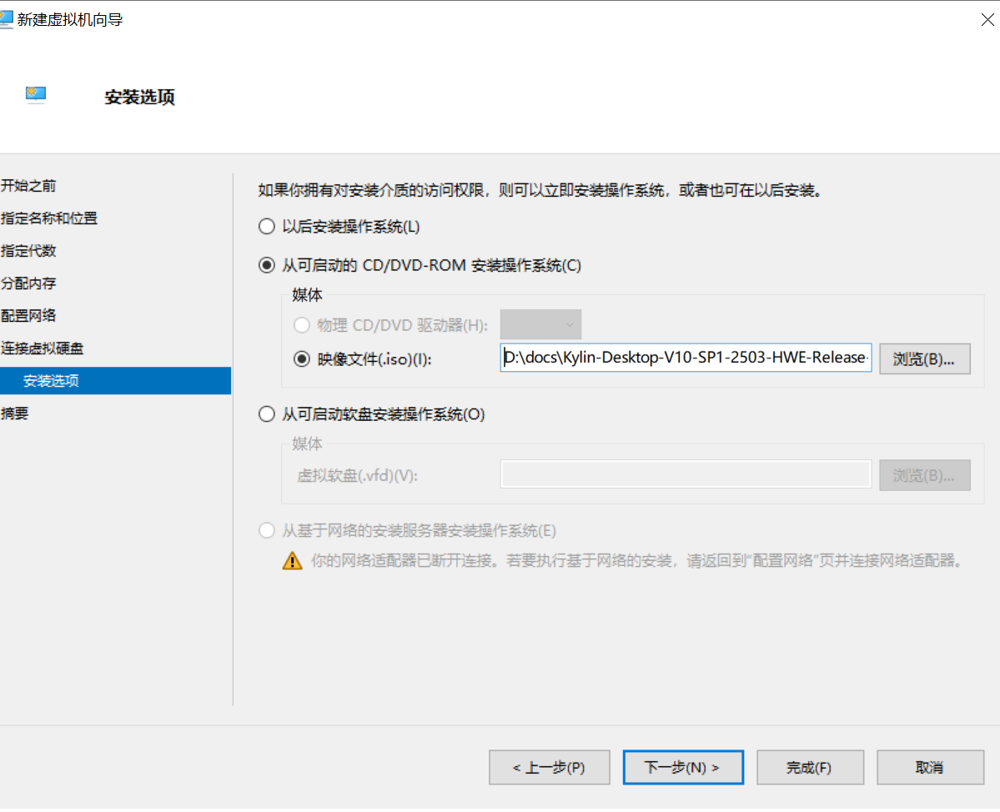
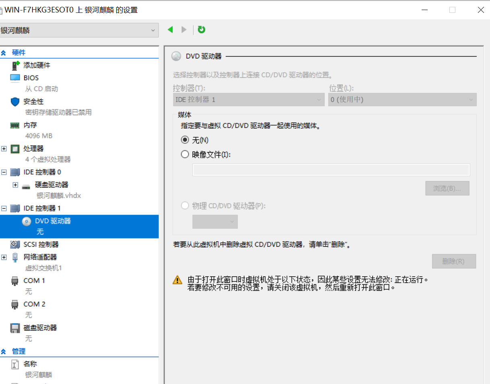
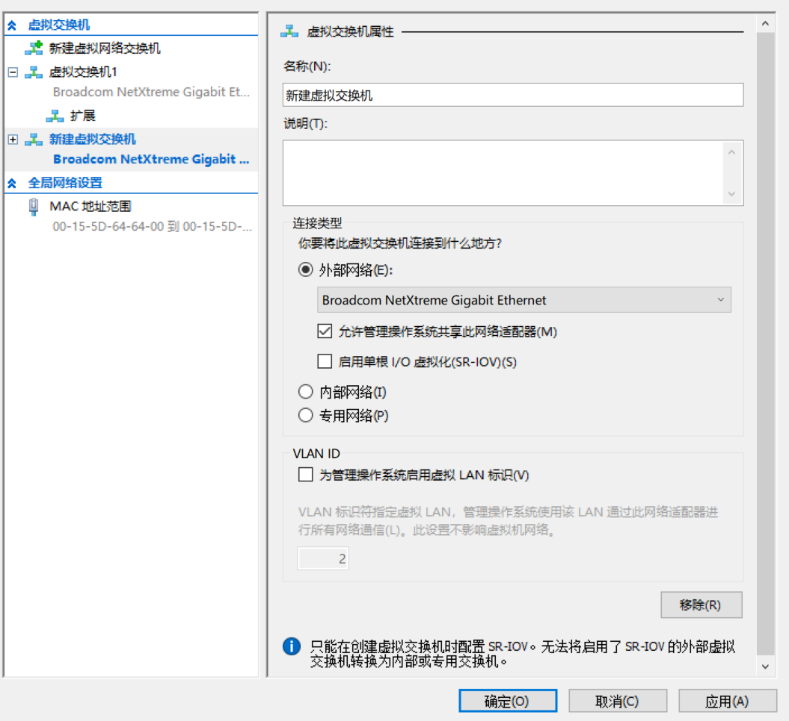
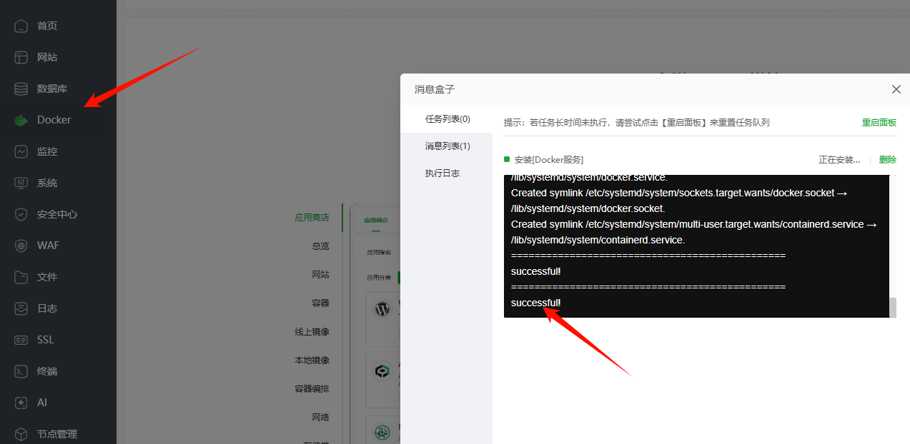

---
title: "Hyper-V 虚拟机安装银河麒麟系统"
date: 2026-11-20
lastmod: 2026-11-20
draft: false
tags: ["Hyper-V", "银河麒麟", "Linux", "SSH", "Docker", "宝塔"]
categories: ["技术", "教程"]
---

# 安装麒麟系统

下载地址：https://iso.kylinos.cn/web_pungi/download/cdn/79jAZvyiVrMUbQ8KDWRNLp4Bt36swzfP/Kylin-Desktop-V10-SP1-2503-HWE-Release-20250430-X86_64.iso

## Hyper-v安装系统



其他都默认设置，选择对应系统文件

安装后记得恢复启动项



把映像文件恢复为“无”后再启动 

# 网络连接

新增一个外部网络的虚拟交换机，并添加到虚拟机中

 

# ssh连接

首先关闭防火墙


## **安装 SSH 服务端**

如果没有安装，执行：

```
sudo apt update
sudo apt install openssh-server -y
```

如果你的银河麒麟使用 RPM 包管理，则先检查：

```
cat /etc/os-release
```

再根据系统版本选择安装方式。

## 启动 SSH 服务

```
sudo systemctl enable ssh
sudo systemctl start ssh
```

查看运行状态：

```
sudo systemctl status ssh
```

如果服务名称是 `sshd`，则执行：

```
sudo systemctl enable sshd
sudo systemctl start sshd
```

## 检查 SSH 端口

默认 SSH 端口是 22：

```
sudo ss -tlnp | grep :22
```

正常应该看到类似：

```
LISTEN 0 128 0.0.0.0:22
```

# 安装宝塔面板

```shell
if [ -f /usr/bin/curl ];then curl -sSO https://download.bt.cn/install/install_panel.sh;else wget -O install_panel.sh https://download.bt.cn/install/install_panel.sh;fi;bash install_panel.sh docscenter
```

# docker

在宝塔里面安装docker

 