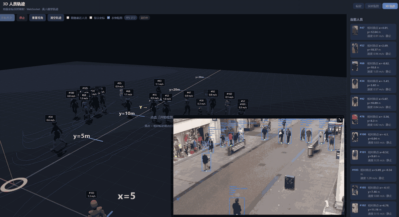

# 人员 3D 轨迹



在浏览器中用 **Three.js** 搭建地面坐标系场景，把后台 YOLO + ByteTrack 检测出的人员，按标定后的地面直角坐标 `(ground_x, ground_y)`（单位：米）映射到 3D 世界中，用骨骼模型实时表现位置、朝向、步态，并绘制行走轨迹线。

## 1. 使用前准备

1. **完成地面标定**  
   在 `/` 标定页完成标定点并保存。3D 落点依赖 Homography 变换；未标定则无法得到正确的地面坐标。

2. **配置视频源**  
   `config/config.yaml` 中配置 RTSP / 本地视频 / 摄像头，与监控页相同。

3. **启动 Web 服务**  
   按 README 启动后，浏览器打开 `/trajectory`。

4. **网络与模型**  
   - 页面通过 importmap 从 unpkg 加载 Three.js `0.160.0`（需能访问外网，或自行改为本地静态资源）。  
   - 人物模型路径：`/static/models/Human.glb`（含 Idle / Walk / Run 等动画）。

---

## 2. 快速上手

1. 打开 `http://127.0.0.1:8080/trajectory`
2. 确认已完成标定
3. 点击 **开始检测**
   - 初始化 3D 场景（地面、网格、坐标轴、刻度）
   - 加载 `Human.glb`
   - 调用 `POST /api/detect/start` 启动后台检测
   - 连接 `ws://…/ws/detect` 接收人员列表
   - 右下角显示监控画面画中画（MJPEG）
4. 观察 3D 模型出场、移动、轨迹线与右侧人员列表
5. 点击 **停止** 结束检测并清理场景中的人员模型

---

## 3. 界面布局

```
┌─────────────────────────────────────────────────────────────┐
│  标题：3D 人员轨迹          [标定] [实时监控] [3D 轨迹]      │
├──────────────────────────────────────────────┬──────────────┤
│  工具栏：开始/停止/重置视角/清空轨迹/开关…    │  当前人员    │
│                                              │  （列表）    │
│  ┌────────────────────────────────────────┐  │              │
│  │           3D 视口 (viewport)           │  │  坐标说明    │
│  │                                        │  │              │
│  │                    ┌──────────┐        │  │              │
│  │                    │ 画中画   │        │  │              │
│  │                    └──────────┘        │  │              │
│  └────────────────────────────────────────┘  │              │
└──────────────────────────────────────────────┴──────────────┘
```

### 3.1 工具栏按钮与开关

| 控件 | 作用 |
|------|------|
| **开始检测** | 建场景、加载模型、启动检测、连 WebSocket、显示画中画 |
| **停止** | 断开 WebSocket、停止检测、隐藏画中画、销毁所有人物与轨迹 |
| **重置视角** | 相机回到默认位置：约 `(0, 8, -6)`，看向 `(0, 0, 12)` |
| **清空轨迹** | 清除所有人员已累积的轨迹点（模型仍保留） |
| **跟随最近人员** | 相机与注视点平滑跟随「距离原点最近」的在场人员 |
| **显示坐标** | 头顶标签除 `#ID` 与速度外，再显示 `x/y`（标定地面坐标） |
| **衣物贴图** | 开启后，对具备外观图的人员从检测画面采样贴到模型上 |
| **FPS / 状态徽章** | 显示检测流水线 FPS，以及「未运行 / 运行中 / 重连中…」等 |

### 3.2 画中画（PiP）

- 源：`GET /api/detect/stream`（与监控页相同的 MJPEG）
- 点击画中画或右上角按钮可放大/缩小；`Esc` 退出放大
- 用于对照「真实视频」与「3D 地面映射」是否一致

### 3.3 侧栏「当前人员」

每条展示：

- `#person_id`
- 相对原点的 `ground_x`、`ground_y`（米）
- 速度（m/s）与方向文案（靠近 / 远离 / 静止 / 未知）
- 若开启「衣物贴图」且该 ID 有外观缓存，显示缩略图

### 3.4 侧栏「坐标说明」

页面内嵌简要说明：原点 O、x/y 含义，以及到 Three.js 世界坐标的映射（详见下一节）。

---

## 4. 坐标系（务必理解）

### 4.1 标定地面坐标（业务坐标）

检测与运动分析使用的是**相对标定原点 O** 的地面直角坐标，**不是**极径距离 `D`：

| 符号 | 含义 |
|------|------|
| `ground_x` | 横向：面向场景时 **左负右正**（米） |
| `ground_y` | 纵深：沿地面远离原点的方向（米） |
| `distance` | \(D = \sqrt{ground\_x^2 + ground\_y^2}\)，到原点的地面距离 |

脚点：检测框底部中心 → Homography → `(ground_x, ground_y)`，再经卡尔曼平滑。

### 4.2 Three.js 世界坐标

映射约定（代码中 `toWorldPos`）：

```text
worldX = -ground_x
worldY = 0          （人站在地面上，竖直向上为 +Y）
worldZ =  ground_y
```

对 `ground_x` 取反，是为了从场景深处（世界 +Z）往回看时，左右与监控画面一致。

场景辅助元素：

- 80m × 80m 地面 + 网格
- 橙色原点环与 `O` 标签
- 标定轴示意：`X+ / X-`、`Y →`（纵深）
- 纵深刻度：`y = 5/10/15/20/30 m`
- 横向刻度：`x = ±5 / ±10 m`（标签为标定 x，位置已按 `-ground_x` 放置）

---

## 5. 数据流与架构

```text
视频源 → LiveDetection（后台线程）
            │
            ├─ MJPEG ──► /api/detect/stream ──► 页面画中画
            │
            └─ 每帧 persons[] ──► WebSocket /ws/detect
                                      │
                                      ▼
                               trajectory.js
                                      │
                    ┌─────────────────┼─────────────────┐
                    ▼                 ▼                 ▼
              侧栏人员列表      PersonAgent 同步     头顶 CSS2D 标签
                                      │
                                      ▼
                         位置平滑 / 朝向 / Idle·Walk·Run
                         轨迹线 / 进出场淡入淡出
```

### 5.1 启动与停止时序

**开始检测：**

1. `initScene()`：WebGLRenderer、CSS2DRenderer、OrbitControls、灯光、地面
2. `loadHumanModel()`：加载 GLB 模板（之后每人 `SkeletonUtils.clone`）
3. `POST /api/detect/start`
4. 设置画中画 `img.src = /api/detect/stream?…`
5. `connectWebSocket()` → `/ws/detect`
6. `resetCamera()`

**停止：**

1. 断开 WebSocket（不再自动重连）
2. `POST /api/detect/stop`
3. 清空画中画、销毁全部 `PersonAgent`、重置列表与徽章

### 5.2 WebSocket 行为

- URL：`ws://<host>/ws/detect`（HTTPS 页面则为 `wss:`）
- 服务端有新检测帧（`seq` 变化）时推送一条 JSON
- 前端关心的类型：
  - `type: "status"`（或历史兼容的 `"ping"`）：更新 FPS、人员、错误
  - `type: "error"`：显示错误条
- 连接意外断开且用户仍希望运行时：约 **1.5s** 后自动重连，状态显示「重连中…」

推送载荷核心字段（在 `type` 之外展开自检测状态）：

```json
{
  "type": "status",
  "running": true,
  "fps": 18.5,
  "seq": 1234,
  "error": null,
  "persons": [
    {
      "person_id": 12,
      "ground_x": 1.25,
      "ground_y": 8.40,
      "distance": 8.49,
      "speed": 1.32,
      "speed_kmh": 4.75,
      "direction": "approaching",
      "timestamp": "2026-10-12 11:20:00",
      "has_appearance": true
    }
  ]
}
```

`direction` 取值：`approaching` | `retreating` | `stationary` | `unknown`（侧栏显示为中文）。

---

## 6. 人物代理（PersonAgent）

每个 `person_id` 对应一个 `PersonAgent`：克隆骨骼模型、动画混合器、轨迹线、头顶标签、材质淡入淡出，以及可选衣物贴图。

### 6.1 生命周期

| 阶段 | 含义 | 行为摘要 |
|------|------|----------|
| `spawning` | 出场 | 在检测落点**外侧约 2.4m** 生成，朝落点走入；约 **0.7s** 淡入，模型从约 0.92× 放大到 1.0×；结束后进入 `active` |
| `active` | 在场 | 平滑追赶最新地面坐标；按速度播 Idle / Walk / Run；行走时累积轨迹点 |
| `exiting` | 离场 | 跟踪丢失超过约 **3s** 后触发；沿最后行进方向以步行速度继续走，约 **0.9s** 淡出后 `dispose` 移除 |
| `disposed` | 已销毁 | 从场景与 Map 中删除，释放几何体/材质/贴图 |

**出场方向：**

- 默认沿「原点 → 检测点」的径向再往外偏移 `SPAWN_OFFSET_M = 2.4`
- 若检测点离原点很近（&lt; 0.4m），则默认从相机一侧（世界 `-Z`）走进，避免穿模感

**跟踪恢复：**

- 离场过程中若该 ID 再次出现在 `persons` 中，会 `cancelExit()`：淡回可见，并回到 `active` 或继续 `spawning`（取决于当前透明度）

### 6.2 位置平滑与死区

- 原始目标：`toWorldPos(ground_x, ground_y)`
- 位移死区约 **0.1m**：跳变更小时不猛追目标，抑制检测抖动
- 目标点再用 `TARGET_FOLLOW` 做指数平滑；模型位置 `smooth` 以追赶速度向目标移动
- 追赶速度：优先用检测 `speed`，过低则用标称步速约 **1.2 m/s**，并限制在约 **0.85～4.5 m/s**；落后过远时适当加速追上

### 6.3 朝向

- 优先用检测点真实位移估计行进方向（EMA 平滑；疑似掉头时混入更慢，减少噪声瞬间反向）
- 尚无有效行进样本且离目标较远时，用「当前位置 → 目标」方向兜底
- 大幅转向需确认时间（约 180ms～450ms），小幅则快速对齐，视觉上更稳

### 6.4 动画状态机

| 条件 | 动画 |
|------|------|
| 基本贴住目标且无近期运动 | `Idle` |
| 在走 / 追赶，显示速度 &lt; 约 2.2 m/s | `Walk`（步频随速度微调） |
| 显示速度 ≥ 约 2.2 m/s | `Run`（若无 Run 片段则回退 Walk 并加快） |
| 离场 | 强制 `Walk` 走离 |

出场阶段强制保持行走，直到走进检测落点附近。

### 6.5 轨迹线

- 统一蓝色（`#3b82f6`），不随靠近/远离变色
- 行走时按位移间隔约 **0.35m** 追加点；最多保留约 **200** 点（FIFO）
- 透明度随人物淡入淡出同步（峰值约 0.85）
- 「清空轨迹」只清点列，不删人

### 6.6 头顶标签（CSS2D）

- 默认：`#ID` + 速度（m/s）
- 勾选「显示坐标」后追加：`x / y`（标定地面米制坐标）
- 透明度随生命周期淡入淡出

---

## 7. 衣物贴图（可选）

开启「衣物贴图」后：

1. 若人员事件带 `has_appearance: true`，请求  
   `GET /api/detect/appearance/{person_id}`
2. 用纹理加载器取 JPEG，通过自定义着色器按**绑定姿势正面投影**映射到躯干 / 头 / 腿，手臂改到画面两侧袖子区域
3. 每个 ID 最多尝试加载约 3 次；关闭开关时恢复默认材质
4. 侧栏同步显示缩略图

说明：贴图来自检测画面裁剪/缓存，效果受角度、遮挡与分辨率影响，主要用于增强辨识度，而非精确换装。

---

## 8. 相机与交互

基于 `OrbitControls`：

| 操作 | 行为 |
|------|------|
| 左键拖拽 | 旋转 |
| 中键 / 右键拖拽 | 平移 |
| 滚轮 | 缩放（距离约 2～80） |
| 重置视角 | 回到俯视偏后的默认机位 |
| 跟随最近人员 | 注视点跟人员胸口高度附近，相机在其后方稍高处平滑跟随；正在 `exiting` 的人不参与「最近」评选 |

极角上限约 89°，避免翻到地面以下。

---

## 9. 相关 HTTP / WebSocket 接口

本页直接使用的接口：

| 方法 | 路径 | 说明 |
|------|------|------|
| GET | `/trajectory` | 返回本页 HTML |
| POST | `/api/detect/start` | 启动后台检测（若已在运行则复用） |
| POST | `/api/detect/stop` | 停止检测 |
| GET | `/api/detect/stream` | MJPEG 画中画 |
| GET | `/api/detect/appearance/{id}` | 人员外观 JPEG（衣物贴图） |
| WS | `/ws/detect` | 按帧推送检测状态与人员列表 |

静态资源：

| 路径 | 说明 |
|------|------|
| `/static/trajectory.html` | 页面结构 |
| `/static/trajectory.js` | 场景、代理、WebSocket 逻辑 |
| `/static/trajectory.css` | 布局与画中画样式 |
| `/static/models/Human.glb` | 人物骨骼与动画 |
| `/static/style.css` | 全站通用样式 |

---

## 10. 源码入口（便于二次开发）

| 文件 | 职责 |
|------|------|
| `web/server.py` | 路由 `/trajectory`、检测 API、`/ws/detect` |
| `web/static/trajectory.html` | DOM：工具栏、视口、侧栏 |
| `web/static/trajectory.js` | Three.js 场景、`PersonAgent`、同步与交互 |
| `web/static/trajectory.css` | 轨迹页专用布局 |
| `src/live_detection.py` | 后台检测线程、状态快照、`seq`、MJPEG |
| `src/pipeline.py` | 检测流水线，组装 `persons` 事件（含 `has_appearance`） |
| `src/motion_analyzer.py` | `ground_x/y`、速度、方向等字段定义 |
| `src/homography.py` | 像素 ↔ 地面坐标 |

关键常量（均在 `trajectory.js` 顶部，可按现场调参）：

| 常量 | 典型值 | 含义 |
|------|--------|------|
| `POS_DEADZONE` | 0.1 m | 忽略的位置噪声 |
| `IDLE_SPEED` | 0.25 m/s | 低于此偏静止 |
| `RUN_SPEED` | 2.2 m/s | 切 Run 的阈值 |
| `WALK_PACE` | 1.2 m/s | 标称步速 |
| `LOST_GRACE_MS` | 3000 | 丢失后多久开始离场 |
| `SPAWN_FADE_SEC` | 0.7 | 出场淡入时长 |
| `EXIT_FADE_SEC` | 0.9 | 离场淡出时长 |
| `SPAWN_OFFSET_M` | 2.4 | 出场外侧偏移 |
| `MAX_TRAIL_POINTS` | 200 | 轨迹点上限 |
| `WS_RECONNECT_MS` | 1500 | WebSocket 重连间隔 |

---

## 11. 常见问题

**3D 里左右和视频反了？**  
检查标定原点与横向点是否按「左负右正」录入；世界坐标已对 `ground_x` 取反，标定错误会直接表现为镜像或偏移。

**人凭空出现/消失？**  
正常流程应有 `spawning` / `exiting`。若跟踪 ID 抖动（同一人频繁换 ID），会表现为多人反复进出场——需从检测/跟踪侧改善，而非仅改前端。

**点击开始后一直「加载模型…」？**  
确认 `web/static/models/Human.glb` 存在且可访问；浏览器控制台查看 GLB 加载错误。

**场景是黑的 / Three 报错？**  
当前依赖 CDN 加载 Three.js，检查网络或改用本地 `three` 静态文件。

**画中画有画面但 3D 没人？**  
确认已标定且 WebSocket 的 `persons` 非空；未标定时脚点变换可能失败或坐标异常。也可在侧栏核对是否有人员条目。

**与监控页抢「开始/停止」？**  
共用同一检测服务：一处停止，全局停止；一处启动，全局运行。轨迹页断开 WebSocket 不会自动停检测，只有点「停止」才会 `POST /api/detect/stop`。

---

## 12. 设计要点小结

1. **业务坐标用直角 `(x, y)`**，距离 `D` 只作列表/方向辅助，不直接驱动 3D 落点。  
2. **视觉连续性**：外侧走进 + 淡入；丢失宽限期 + 沿行进方向走离 + 淡出。  
3. **检测与表现解耦**：后端给稀疏、带噪声的地面点；前端用死区、平滑、朝向确认和动画掩盖抖动。  
4. **与监控页同源**：同一检测线程、同一 WebSocket、同一标定与视频源，便于对照验证标定是否正确。
