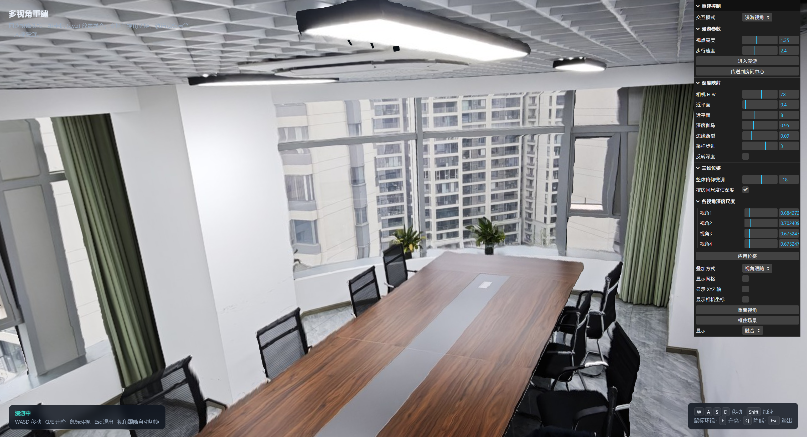

# 多视角深度重建

 

基于 [Three.js](https://threejs.org/) + [Vite](https://vitejs.dev/) 的浏览器端三维重建演示：用**固定机位**摄像头的彩色图与 Depth Anything V2 深度图，按已知三维坐标放置并融合，支持单视角切换、轨道观察与第一人称漫游。

**设计要点：固定视角、尽量少机。** 机位在场景中预先标定、朝向固定，不依赖动态跟踪；在能覆盖目标空间的前提下尽可能减少摄像头数量。本 Demo 以会议室为例，采用 **4 路**固定机位即可完成融合重建。

## 功能

- 固定机位多视角深度网格生成与融合（本 Demo：4 路）
- 单视角 / 融合切换，深度尺度自动估计
- 轨道观察与 WASD 第一人称漫游
- lil-gui 面板调节 FOV、深度范围、融合模式等

## 环境要求

- [Node.js](https://nodejs.org/)（建议 18+）
- Python 3（仅处理资源时需要：`npm run prepare-assets`）

## 快速开始

**方式一：双击启动（Windows）**

```text
start.bat
```

首次运行会自动 `npm install`，随后打开开发服务器（默认 [http://localhost:5173](http://localhost:5173)）。

**方式二：命令行**

```bash
npm install
npm run prepare-assets   # 若尚未生成 public/assets 下的深度图
npm run dev
```

其他脚本：

| 命令 | 说明 |
|------|------|
| `npm run build` | 生产构建 |
| `npm run preview` | 预览构建产物 |
| `npm run prepare-assets` | 将 `assets/source` 转为可用的深度 PNG 等 |

## 目录结构

```text
├── assets/source/          # 原始彩色图 + 深度图（按 camId）
├── public/assets/          # 运行时资源与 manifest.json
├── scripts/prepare_depth.py
├── src/                    # 前端源码
│   ├── main.js             # 入口与场景控制
│   ├── depthMesh.js        # 深度网格
│   ├── calibrate.js        # 位姿 / 深度尺度
│   ├── assets.js           # 资源与坐标映射
│   ├── roamControls.js     # 漫游控制
│   └── worldAxes.js
├── index.html
├── vite.config.js
└── start.bat
```

资源约定与坐标系说明见 [assets/README.md](assets/README.md)。

## 操作说明

### 场景交互

| 模式 | 操作 |
|------|------|
| 轨道观察 | 左键拖拽旋转 · 滚轮缩放 · 右键平移 |
| 漫游视角 | WASD 移动 · 鼠标环视 · Shift 加速 · E 升高 · Q 降低 · Esc 退出 |

### 右侧「重建控制」面板

页面右侧为 lil-gui 控制面板，可调显示、交互与重建参数。改动深度相关项后会触发网格重建，稍候片刻即可看到效果。

#### 顶层

| 控件 | 说明 |
|------|------|
| **显示** | `融合`：叠加全部机位；或选单个视角名称，只看该路重建 |
| **交互模式** | `轨道观察`：绕场景旋转查看；`漫游视角`：进入第一人称行走 |
| **叠加方式** | 仅在「显示 = 融合」时有意义：`不透明` 各视角互不透视；`半透明` 多层叠加以便对齐；`视角跟随` 按当前视线方向自动高亮最匹配的一路（漫游时尤其有用） |
| **显示网格** | 地面参考网格 |
| **显示 XYZ 轴** | 世界坐标系辅助轴 |
| **显示相机坐标** | 各机位局部坐标轴，便于核对摆放 |
| **重置视角** | 轨道模式下恢复初始相机 |
| **框住场景** | 自动拉远/对准，使整场景落入视野 |

#### 漫游参数

| 控件 | 说明 |
|------|------|
| **视点高度** | 第一人称眼睛离地高度（米） |
| **步行速度** | WASD 移动速度 |
| **进入漫游** | 请求指针锁定并开始漫游 |
| **传送到房间中心** | 瞬移到场景中心再开始漫游 |

#### 深度映射

控制相对深度如何投影成三维网格（改完会重建）：

| 控件 | 说明 |
|------|------|
| **相机 FOV** | 反投影用的视场角；与实拍镜头越接近，几何越准 |
| **近平面 / 远平面** | 深度映射的最近/最远距离（米）；裁剪过近噪声或过远背景 |
| **深度伽马** | 压缩或拉伸深度分布；大于 1 拉开远处，小于 1 拉开近处 |
| **边缘断裂** | 深度跳变处撕开三角面，减轻遮挡边缘「拉丝」 |
| **采样步进** | 像素抽样步长；越大网格越稀、越快，细节越少 |
| **反转深度** | 近远取反（伪彩解码方向不对时可试） |

#### 三维位姿

| 控件 | 说明 |
|------|------|
| **整体俯仰微调** | 所有机位统一上下俯仰（度），用于对齐桌面/地面 |
| **按房间尺度估深度** | 开启时按机位间距自动估计各路深度尺度 |
| **各视角深度尺度** | 手动微调每一路的深度缩放（关闭自动估计后更常用） |
| **应用位姿** | 按当前参数重新放置各视角网格 |

## 获取深度图（Depth Anything V2 在线 Demo）

本项目的 `prepare-assets` 会把 **Spectral_r 伪彩深度图** 反解成灰度深度，因此请使用官方 Demo 界面上的**彩色深度可视化结果**，不要用页面提供的灰度 / 16-bit 下载文件。

1. 打开官方在线 Demo：  
   [https://huggingface.co/spaces/depth-anything/Depth-Anything-V2](https://huggingface.co/spaces/depth-anything/Depth-Anything-V2)
2. 在左侧上传该机位的彩色图（与后续 `color.jpg` 为同一张）。
3. 点击 **Compute Depth**，等待右侧出现深度对比滑条。
4. 保存右侧的 **Spectral_r 伪彩深度图**（红/黄偏近、蓝/紫偏远），命名为 `depth.webp`（也可用 `.png` / `.jpg`，再在 `manifest.json` 的 `source.depth` 中写明路径）。
5. 与彩色图一起放入 `assets/source/<camId>/`，再执行 `npm run prepare-assets`。

说明：伪彩图经 `scripts/prepare_depth.py` 按 Spectral_r 查找表还原为灰度后写入 `public/assets/<camId>/depth.png`。

## 新增摄像头

1. 按上一节用在线 Demo 得到深度图；将 `color.jpg`、`depth.webp` 放入 `assets/source/<camId>/`
2. 在 `public/assets/manifest.json` 登记路径与 `pose: {x,y,z}`（单位：米，z 为高度）
3. 运行 `npm run prepare-assets`

坐标映射：`three(x, y, z) = user(y, z, x)`。
