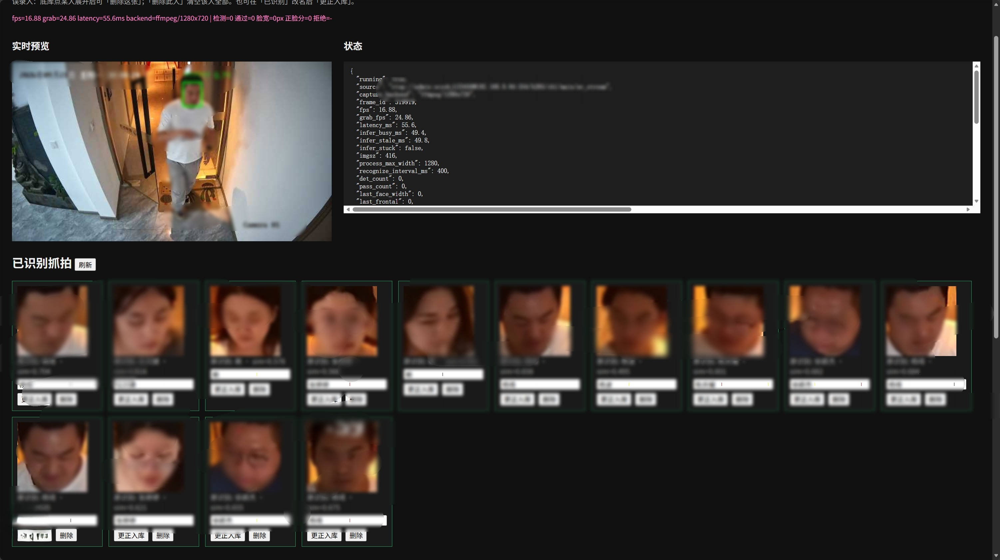
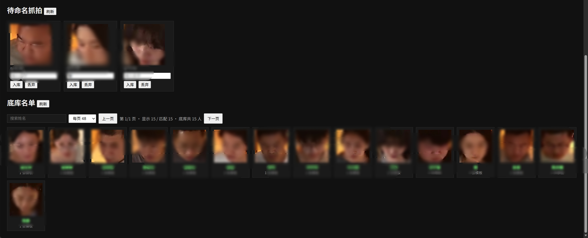

# 安防通行人脸抓拍识别（Passage Face Recognition）

项目地址：[YQisme/Passage-Face-Recognition:。](https://github.com/YQisme/Passage-Face-Recognition)

近景 / 监控流人脸检测 + ArcFace 1:N 识别 HTTP 服务。启动后自动拉流、抓拍、比对底库，并在网页上完成待命名入库与纠错。

## 应用场景

面向**安防摄像头**在**自然通行场景**下的近景抓拍与 1:N 识别，适合门口、通道、前台、闸机口等人员会走过并短暂正对镜头的位置；不适合远景全景监控、纯俯拍、大侧脸或快速奔跑抓拍作为主路径。







### 安防摄像头与自然场景

| 类型 | 适用说明 |
|------|----------|
| 安防 / 网络摄像头（RTSP 主码流） | 主路径；建议主码流 + `process_max_width: 1280`，保证脸宽足够 |
| 室内自然光 / 过道灯光 | 正常；过暗过曝会被质量门控拒绝（可调 `brightness_*`） |
| 室外自然场景 | 可用，但逆光、强阴影、雨雾会降低检出与相似度 |
| 子码流 / 低分辨率远景 | 不推荐；人脸易小于 `min_face_width`（默认 60px）被丢弃 |

典型用法：通道口固定机位持续拉流 → 过路人正脸一瞬被抓拍 → 自动比对底库；未命中进「待命名」，命中进「已识别」，均可人工纠错再入库。

网页右上角 **设置**：可热改质量门控、比对阈值、检测 conf、batch 等待，以及抓拍保存时长（天/月）和总空间上限；也可改 **视频源 / 队列容量**（写回 YAML 后需点「完整重启」生效）。设备 / 权重 / 端口仍需改配置后重启。清理范围是已识别、待命名和调试抓拍，不含底库已录入照片。

### 摄像头高度与人脸角度

识别依赖正脸几何约束（默认 `max_yaw_deg` / `max_pitch_deg` = **25°**，`min_frontal` = **0.72**）。安装与通行路径建议：

| 维度 | 建议 | 说明 |
|------|------|------|
| 安装高度 | 约 **1.6～2.2 m** | 与成人面部高度接近；过高易成俯视大俯角，过低易成仰视 |
| 俯仰角 | 镜头略俯视或接近水平 | 人脸相对镜头的 **pitch 宜 \|pitch\| ≤ 25°**；天花板高吊、大俯角易 `pitch_too_large` / `not_frontal` |
| 水平朝向 | 正对通行方向 | 左右偏头 **yaw 宜 \|yaw\| ≤ 25°**；侧面机位、大侧脸易被拒 |
| 人脸在画面中大小 | 脸宽 ≥ **60 px**（处理分辨率下） | 机位过远或只用子码流易 `face_too_small` |
| 通行距离 | 约 **1～4 m**（视焦距与分辨率） | 过近易裁切/模糊；过远脸太小、细节不足 |

安装示意：人正面走过镜头前的「正脸走廊」——机位正对来向、高度贴近面部、避免纯侧面与大俯拍。偏头、低头看手机、只露后脑勺等情况会被质量模块过滤，属预期行为。

现场调参：抓不到可略降 `min_face_width` / `min_frontal`，或放宽 `max_yaw_deg` / `max_pitch_deg`；误抓杂脸（后脑勺等）则提高 `min_det_score`、`min_frontal`。

## 快速开始

```bash
# 在 根目录下执行
# 首次：复制本地配置并填写 RTSP / device 等（勿提交）
cp config.yaml config.local.yaml

# 一键启停（推荐；默认读 config.local.yaml）
bash start_face_serve.sh
bash stop_face_serve.sh

# 或前台运行
python serve.py
```

- 监控页：`http://<主机>:8080/`
- 健康检查：`curl http://127.0.0.1:8080/health`
- 日志 / PID：`logs/face_serve.log`、`logs/face_serve.pid`

可选环境变量（启动脚本）：`HOST` `PORT` `DEVICE` `SOURCE` `CONFIG`

```bash
PORT=8081 DEVICE=cuda:0 bash start_face_serve.sh
```

## 目录结构

```text
face/
├── serve.py              # HTTP 服务入口
├── service.py            # 拉流 / 推理线程
├── pipeline.py           # 检测 → 质量 → 对齐 → 特征 → 比对
├── detect.py             # YOLOv8n-Face（含五点）
├── arcface.py            # ArcFace 特征
├── gallery.py            # 底库 / 待命名 / 已识别
├── quality.py            # 清晰度、正脸、亮度等
├── config.yaml           # 可提交的配置模板
├── config.local.yaml     # 本地配置（gitignore，含 RTSP 等）
├── start_face_serve.sh   # 后台启动
├── stop_face_serve.sh    # 停止
├── enroll.py             # 离线图片录入底库
├── run_video.py          # 本地视频/摄像头调试
├── weights/              # yolov8n-face.pt、backbone.pth
├── gallery/              # 底库与抓拍
│   ├── candidates/       # 待命名抓拍
│   └── recognized/       # 已识别抓拍
└── logs/                 # 服务日志
```

## 识别结果与「待命名抓拍」

比对使用余弦相似度，阈值见 `config.local.yaml` / `config.yaml` 的 `match` 段（默认）：

| 相似度分数 | 状态 | 去向 | 名字字段 |
|-----------|------|------|----------|
| ≥ `match_threshold`（0.45） | `matched` | 「已识别抓拍」 | 确定命中人名 |
| ≥ `candidate_threshold`（0.35）且 &lt; 0.45 | `candidate` | 「待命名抓拍」 | **预填最像的人名**（`ref_name`，仅建议） |
| &lt; 0.35 | `unknown` | 「待命名抓拍」 | 为空，需人工命名 |

要点：

- **待命名里出现名字，不等于已经入库。** 那是中间档相似度下的建议名，方便点「入库」时确认或改名。
- 建议名不对：改掉再入库，或点「丢弃」。
- 「已识别抓拍」可「更正入库」：按正确姓名再写入底库，并清理旧名下过于相似的模板。
- 点击已识别卡片可看详情与**现场截图**（绿框 + 姓名）；姓名支持中文（Pillow + `assets/fonts/`，仅落盘时绘制，不影响预览帧率）。

调严 / 调松：提高 `match_threshold` 更不易误识；降低 `candidate_threshold` 会有更多「带建议名」的待命名。

## 网页功能

打开 `/` 后可：

1. 看 MJPEG 预览与运行状态  
2. **待命名抓拍**：命名入库 / 丢弃  
3. **已识别抓拍**：纠错入库 / 丢弃  
4. **底库**：浏览每人多角度模板，删除整人或单张模板  
5. 上传图片录入（`POST /enroll`）

## 主要配置（`config.local.yaml` / `config.yaml`）

| 配置项 | 说明 |
|--------|------|
| `server.host` / `port` | 监听地址，默认 `0.0.0.0:8080` |
| `source` | 摄像头索引 / 视频文件 / RTSP |
| `model.device` | `cuda:N` / `auto` / `cpu`；扫卡后会释放未选中卡的临时 CUDA context |
| `model.process_max_width` | 处理前最长边缩放（抓拍清晰度与速度） |
| `quality.*` | 最小脸宽、模糊、正脸角、关键点置信度等 |
| `match.match_threshold` | 判定为已识别 |
| `match.candidate_threshold` | 进入待命名并可能带建议名 |
| `match.max_templates_per_person` | 同名最多保留模板数 |

抓拍建议用主码流 + `process_max_width: 1280`；子码流分辨率过低时容易 `face_too_small`。

## HTTP 接口摘要

| 方法 | 路径 | 说明 |
|------|------|------|
| GET | `/` | 监控页 |
| GET | `/health` | 健康检查 |
| GET | `/status` | 运行状态 |
| GET | `/settings` | 可热改配置快照 |
| POST | `/settings` | 热更新配置（JSON；`persist` 写回 YAML） |
| POST | `/restart` | 完整重启进程（`{"confirm":true}`；前端有按钮） |
| GET | `/events` | 最近识别事件 |
| GET | `/snapshot.jpg` | 最新标注帧 |
| GET | `/stream.mjpg` | MJPEG 预览 |
| GET | `/gallery` | 底库名单 |
| DELETE | `/gallery/person` | 删除某人全部模板 |
| GET | `/candidates` | 待命名列表（含 `ref_name` / `score`） |
| POST | `/candidates/{id}/enroll` | 待命名入库（form: `name`） |
| DELETE | `/candidates/{id}` | 丢弃待命名 |
| GET | `/recognized` | 已识别列表 |
| POST | `/recognized/{id}/enroll` | 纠错入库（form: `name`） |
| POST | `/enroll` | 上传图片录入（multipart: `name` + `image`） |

## 离线工具

```bash
# 从图片录入底库
python enroll.py --name 张三 --image ./photos/zs.jpg
python enroll.py --name 李四 --image ./photos/lisi_dir/

# 本地视频 / 摄像头调试（不启 HTTP）
python run_video.py --source 0
python run_video.py --source /path/to/video.mp4 --device cuda:0 --no-show
```

## 权重

模型文件不入库（`backbone.pth` 约 167MB，超过 GitHub 100MB 限制）。下载后放到 `weights/`，说明见 [`weights/README.txt`](weights/README.txt)。

| 文件 | 用途 | 下载 |
|------|------|------|
| `yolov8n-face.pt` | 人脸检测（五点关键点） | [Google Drive](https://drive.google.com/file/d/1qcr9DbgsX3ryrz2uU8w4Xm3cOrRywXqb/view?usp=sharing)（[derronqi/yolov8-face](https://github.com/derronqi/yolov8-face)） |
| `backbone.pth` | ArcFace MS1MV3 IResNet50 | 官方包内 `arcface_torch/ms1mv3_arcface_r50_fp16/backbone.pth`。[OneDrive](https://1drv.ms/u/s!AswpsDO2toNKq0lWY69vN58GR6mw?e=p9Ov5d) / [百度网盘](https://pan.baidu.com/s/1CL-l4zWqsI1oDuEEYVhj-g)（提取码 `e8pw`）。仅供非商业研究使用。 |

## 依赖

见 `requirements.txt`（ultralytics、opencv、torch、fastapi、uvicorn、PyYAML 等）。RTSP 拉流依赖本机 `ffmpeg`（CoreX 环境一般在 `/usr/local/corex-4.1.3/bin/ffmpeg`）。

## GPU 说明

- `device: cuda:N`：优先该卡；不可用或空闲不足时自动改选空闲显存最多的卡（`auto` 则始终自动选）。
- 用 torch 查询各卡显存时会短暂创建多卡 context；选中后对其余卡 `cudaDeviceReset` 释放，进程应只留在目标卡上。
- 启动脚本也可提前设置 `CUDA_VISIBLE_DEVICES`，进程内统一用 `cuda:0`。
