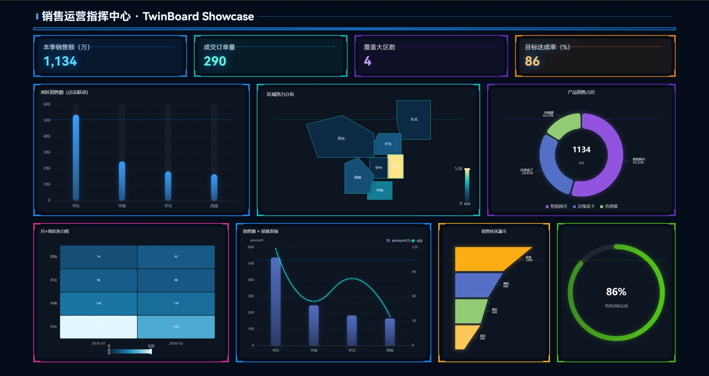

# TwinBoard



项目地址：[YQisme/TwinBoard](https://github.com/YQisme/TwinBoard)

数字孪生大屏设计器 —— 可视化 BI 大屏平台：在浏览器里完成 **设计 → 绑定真实数据 → 预览 → 发布**。

目标不是再做一个静态 JSON 画板，而是打通完整链路：

```
数据源 → 数据查询 → 数据处理 → 可视化组件 → 交互 / 动效 → 大屏 → 发布
```

---

## 功能一览

- 项目、页面、画布设计器、基础图表、静态/API/JSON 绑定、预览发布
- 数据源管理：MySQL / PostgreSQL / SQL Server / REST / JSON，连接测试、权限
- 数据查询与处理：SQL、字段、过滤、分组聚合、时间范围、参数化、缓存、定时刷新
- 高级图表：双轴、组合、雷达、散点、热力、漏斗、桑基、自定义、区域地图
- 动态效果：进入动画、数字滚动、图表过渡、轮播、场景背景图上传、视频/粒子背景
- 高级交互：下拉/时间筛选、图表联动增强、钻取、弹窗（全局变量 / 基础联动已有）
- 模板管理：页面/组件模板导入导出
- 发布与运行：版本管理、URL 参数、公开态数据集查询（预览/发布/导出/网页组件已有）
- 协作权限、系统管理、性能安全与部署

---

## 技术栈

| 端 | 技术 |
|---|---|
| 前端 | Vue 3、TypeScript、Vite 7、Pinia、Vue Router、Element Plus、ECharts 5 |
| 后端 | ASP.NET Core 8 Minimal API |
| 数据源驱动 | MySqlConnector、Npgsql、Microsoft.Data.SqlClient |

前端默认请求 `http://localhost:8080/api`。

---

## 环境要求

- Node.js 18+（建议 20）
- .NET SDK 8
- 可选：本机 MySQL / PostgreSQL / SQL Server（演示可只用内置 JSON 数据源）

---

## 快速开始

在两个终端分别启动后端和前端。

**1. 启动 API**

```powershell
cd backend
dotnet run
```

API 监听：`http://localhost:8080`  
首次启动会在 `backend/` 下自动创建 SQLite 文件 `dashboard.db`（用户、项目、页面等持久化于此）。

**2. 启动前端**

```powershell
cd frontend
yarn
yarn dev
```

设计器地址：`http://localhost:5173`

**3. 登录**

| 用户名 | 密码 | 角色 | 数据源权限 |
|---|---|---|---|
| `admin` | `123456` | 管理员 | 全部数据源的查看、编辑、删除 |
| `editor` | `123456` | 编辑者 | 可创建；只能改自己的数据源 |
| `viewer` | `123456` | 查看者 | 只读共享数据源，不能新建 |

---

## 推荐试用路径

1. 登录后进入 **数据中心**，确认已有预置数据：
   - 数据源：`示例销售数据`（JSON）
   - 数据集：`示例销售明细`、`地区销售汇总`、`地区销售（可筛选）`
2. 新建项目 → 进入设计器。
3. 从左侧点开 **柱状图**，在样式面板里选一种样式（可点击或拖到画布）；或直接拖入 **数字指标**。
4. 右侧数据绑定：数据源选「数据集」，绑定 `地区销售汇总`。
5. 需要等比例放大时：选中组件，**按住 Shift** 拖角点/边点，宽高与字号同步变化。
6. 点击画布空白处进入页面配置，点 **上传背景图片** 添加场景背景。
7. 在页面配置里打开「加载动画」，动态特效可选「网格」或「粒子」。
8. 点 **预览** 查看动效（打开独立预览页）。
9. 点 **发布**，获得 `/dashboard/{publishKey}` 访问地址。

没有真实数据库时，用预置 JSON 即可走完「数据源 → 数据集 → 图表」全流程。

---

## 模块说明

### 1. 项目管理

路径：`/projects`

- 创建 / 删除项目
- 进入项目后管理页面：新建、复制、删除、打开设计器、预览（封面图为预览缩略图）
- 已发布页面会显示访问链接

### 2. 设计器

路径：`/designer/{projectId}?pageId={pageId}`

布局：

- 左侧：组件库、图层、页面列表
- 中间：1920×1080 画布（可缩放、网格、标尺、吸附）
- 右侧：数据绑定、样式属性、交互、动画

画布能力：

- 拖拽添加组件，框选、多选
- 移动、缩放、旋转（`Shift` 拖控制点可等比例缩放，字号同步放大/缩小）
- 对齐、分布、编组
- 撤销 / 重做
- 预览（保存后打开独立预览页）

**添加场景背景**

1. 点击场景任一空白处，切换到右侧 **页面配置**（场景配置）
2. 点击 **上传背景图片**，选择本地图片
3. 画布立即显示场景背景；保存后预览 / 发布页同样生效

说明：

- 上传成功后会自动将「背景类型」设为 **图片**
- 也可将背景类型手动设为「图片」后，粘贴图片 URL
- 本地图片建议小于 4MB；支持更换、清除
- 背景类型还支持：纯色、视频（填 mp4 地址）、特效（网格 / 粒子 / 光晕）

**组件库与图表样式**

- 普通组件：点击添加，或拖到画布
- 有多样式的图表（柱状、折线、饼图、仪表盘等）：**点击图标**打开样式面板，列出该类型全部样式
- 样式卡片支持 **点击添加**，或 **按住拖到画布** 指定位置；拖动时遮罩穿透，不挡住画布放置
- 添加到画布后，仍可在右侧属性面板「图表款式」中切换样式

保存后才会写入后端。标题栏出现「未保存」表示本地有改动。

### 3. 数据中心

路径：`/data`

**数据源类型**

| 类型 | 配置要点 |
|---|---|
| MySQL | Host / Port(3306) / Database / 账号密码 |
| PostgreSQL | 默认端口 5432 |
| SQL Server | 默认端口 1433 |
| REST API | URL、GET/POST、Header JSON、Body、数据路径如 `data.list` |
| JSON | 内嵌 JSON 文本，可选数据路径 |

支持：测试连接、预览、保存/编辑/删除、团队共享或仅自己可见。

**数据集（查询层）**

在数据源之上配置一次，供多个图表复用：

- SQL 库：写 `SELECT`（仅只读，禁止写操作关键字）
- REST / JSON：写数据路径，或留空使用数据源默认路径
- 字段选择、条件过滤、时间范围
- 分组 + 聚合（sum / avg / max / min / count）
- 排序、返回行数
- 缓存秒数、定时刷新秒数
- 参数：`{{region}}`、`{{start}}`、`{{end}}`

过滤条件里的 `{{region}}` 若运行时没有传参，会自动跳过，便于「先看全部，再按地区筛选」。

SQL 中的 `{{name}}` 会替换为字面量（数字原样写入，字符串自动转义），预览前请在「参数调试」里填测试值。

### 4. 组件数据绑定

图表 / 指标 / 表格 / 地图支持四种来源：

| 来源 | 说明 |
|---|---|
| 静态数据 | 组件内 JSON |
| JSON | 同上，便于和静态切换 |
| API | 填 URL，由后端代理拉取 |
| 数据集 | 走数据中心的统一查询层（推荐） |

统一结果格式始终是：

```json
{
  "columns": ["region", "amount"],
  "rows": [{ "region": "华东", "amount": 186 }]
}
```

高级图表只是字段映射不同，不另做数据结构。

### 5. 图表组件

**基础**

文本、富文本、图片、SVG、网页、矩形、圆形、容器、柱状图、折线图、饼图、环形图、面积图、仪表盘、数字指标、表格、边框/标题/分割线装饰。

**图表样式（款式）**

部分图表类型提供多种预设样式，例如：

| 类型 | 示例样式 |
|---|---|
| 柱状图 | 普通、分组、堆叠、条形、堆叠条形 |
| 折线图 | 普通、阶梯、多折线、虚线 |
| 面积图 | 普通、堆叠、多面积 |
| 饼图 / 环形图 | 普通、玫瑰、南丁格尔 / 细环等 |
| 漏斗 / 雷达 / 散点 | 升降序与金字塔、单/多系列、气泡等 |
| 仪表盘 | 半圆、全圆、进度环 |

用法：

1. 左侧组件库点击图表图标 → 弹出全部样式
2. 点击某样式直接放到画布，或拖到画布落点
3. 选中组件后，属性面板「图表款式」可再切换；多系列样式需绑定系列字段或额外指标

等比例缩放（`Shift` + 拖控制点）时，组件 `字号` 会按比例变化；图表标题、轴标签、图例、指标卡文字等会跟着更新。

**网页组件（iframe）**

拖入「网页」组件，填写可被 iframe 打开的地址。把组件铺满画布并置底，即可当作三维 / GIS / **UE 像素流** 背景。

| 项 | 说明 |
|---|---|
| 页面地址 | 支持 `{{变量名}}`，运行时替换为全局变量 |
| 铺满作背景 | 锁定为画布大小并置于底层，设计器里不可拖动 |
| 铺满并置底 | 属性面板按钮，一键铺满 + 置底 |
| 运行时可交互 | 预览/发布后是否允许操作嵌入页；作背景且不需要旋转三维时可关闭 |
| 同步变量消息 | 与嵌入页 `postMessage` 双向通信 |
| 刷新秒 | 定时重载页面，0 表示不刷新 |

设计器中嵌入页不可点击，避免抢鼠标。预览 / 发布后才可交互。对方站点若设置了 `X-Frame-Options` 或 CSP `frame-ancestors`，会显示空白。

父页发给嵌入页：

```json
{ "source": "rbi", "type": "variables", "variables": { "region": "华东" } }
```

嵌入页改大屏变量：

```json
{ "source": "rbi", "type": "variable", "key": "region", "value": "华东" }
```

**UE 像素流（Pixel Streaming）**

可以嵌，嵌的是 **像素流播放页**，不是裸码流。适合把 Unreal 三维场景当大屏底图，上面再叠图表。

配置：

1. 拖入「网页」，地址填播放器页，例如 `https://your-ps-server/`、`/player.html` 或 `/?StreamerId=Default`
2. 点「铺满并置底」
3. 「运行时可交互」保持开启
4. **刷新秒必须为 0**，否则会掐掉 WebRTC 再重连
5. 在 **预览 / 发布页** 里测交互；设计器会挡住鼠标，不能在编辑态转场景

| 注意 | 说明 |
|---|---|
| 鼠标对不准 | 运行时用 CSS `scale` 适配时，WebRTC 点击/拖动会偏。页面适配改成 **固定**，分辨率与显示器一致（如 1920×1080） |
| 设计器也会连流 | 设计器里 iframe 仍会加载地址。像素流常限制 1 个观看端，开着设计器时发布页可能连不上 |
| 图表挡住操作 | 没被组件盖住的区域才能旋转场景；WASD 需先点一下三维区域拿回焦点 |
| 图表不能直接驱动 UE | 默认播放器不认上面的 `rbi` 消息。要联动需在播放页转发到 `stream.emitUIInteraction(...)`，UE 里绑 `OnUIInteraction` |
| HTTPS | 大屏若是 HTTPS，像素流也必须 HTTPS + WSS，否则 iframe 被拦 |
| 性能 | 一路 1080p/4K 很吃带宽和 GPU。设计器、预览、发布不要同时开同一路流 |
| 禁止嵌套 | 对方若设置了 `X-Frame-Options: DENY` 或 CSP `frame-ancestors`，画面空白 |

播放页转发示例（自定义 player 中）：

```js
window.addEventListener("message", (event) => {
  const data = event.data;
  if (!data || data.source !== "rbi" || data.type !== "variables") return;
  stream.emitUIInteraction(data.variables);
});
```

建议：

| 目标 | 做法 |
|---|---|
| 三维当底、图表叠上面 | 网页组件 + 铺满作背景 + 可交互 |
| 只展示、不转场景 | 关掉「运行时可交互」 |
| 图表驱动镜头 / 高亮 | 自定义播放页转发 `postMessage` → `emitUIInteraction` |
| 鼠标精确 | 适配选「固定」，不要用等比缩放 |

**高级**

| 组件 | 字段 |
|---|---|
| 柱线组合 | 维度 + 主指标 + 次指标 |
| 双轴图 | 柱 + 线，左右 Y 轴 |
| 多轴图 | 三个指标、三条轴 |
| 雷达图 | 维度当指示器 |
| 散点图 | 名称 + X + Y，可选气泡大小 |
| 热力图 | X 维度 + Y 维度 + 值 |
| 漏斗图 | 维度 + 指标 |
| 桑基图 | 来源 + 去向 + 值 |
| 自定义图表 | 填写 ECharts option JSON，系统注入 `dataset` |
| 地图 | 绑定地区名称（华东/华南/华北等）做区域填色 |

自定义图表 option 示例（不必手写 data）：

```json
{
  "tooltip": { "trigger": "axis" },
  "xAxis": { "type": "category" },
  "yAxis": { "type": "value" },
  "series": [{ "type": "bar" }]
}
```

### 6. 交互（当前能力）

组件「交互」面板：

- **页面跳转**：跳到项目内另一页，可带 `region=华东` 这类参数
- **组件联动 / 变量控制**：点击后写入全局变量
- 图表点击类目名（如「华东」）可写入变量
- 其它组件通过「筛选变量」读取该变量，过滤或作为数据集参数

示例：柱状图点击「华东」→ 变量 `region=华东` → 其它图绑定数据集 `地区销售（可筛选）`，筛选变量填 `region`。

更完整的下拉筛选、钻取、弹窗见规划中的 3.5。

### 7. 动效与场景背景

取消选中组件后编辑 **页面配置**（点击画布空白处即可）：

| 项 | 说明 |
|---|---|
| 背景类型 | 纯色 / 图片 / 视频 / 特效 |
| 背景图 | **上传背景图片**，或填写图片 URL；上传后自动切到「图片」类型 |
| 背景色 | 纯色底，或图片未铺满时的底色 |
| 背景视频 | 可公开访问的 mp4 地址 |
| 动态特效 | 网格 / 粒子 / 光晕 |
| 加载动画 | 预览/发布进入时播放 |
| 进入错峰 | 组件依次进入的间隔（毫秒） |
| 适配 | 等比缩放 / 固定尺寸 |

三维 / UE 像素流：用组件库「网页」铺满作背景，见上文「UE 像素流」。

选中组件后，属性底部 **动画**：

| 项 | 说明 |
|---|---|
| 进入动画 | 淡入、上滑、左滑、缩放、弹入 |
| 循环动画 | 呼吸、漂浮、发光、旋转（设计器里也能看到） |
| 数字滚动 | 指标卡数值变化时滚动，默认开启 |
| 自动轮播 | 表格滚动行；或多个组件填同一「轮播分组」轮流显示 |
| 实时刷新 | 未单独设刷新秒数时，默认每 5 秒拉数 |

设计器编辑时不播放进入动画，避免拖拽被打断。预览 / 发布页会播放。

### 8. 预览与发布

| 模式 | 地址 | 说明 |
|---|---|---|
| 独立预览 | `/preview/{pageId}` | 需登录，读取已保存内容；设计器工具栏「预览」、页面列表封面/「预览」均可打开 |
| 发布大屏 | `/dashboard/{publishKey}` | 公开访问，使用发布时快照 |
| 取消发布 | 页面列表 / 设计器「取消发布」 | 清除公开地址，原链接失效 |
| 导出离线包 | 页面列表 / 设计器「导出」 | 下载含 `index.html`、`css/`、`js/` 的 zip，解压后可独立打开 |

保存页面时会截取设计器画布作为封面缓存；页面列表卡片会直接渲染缩小版真实预览（与预览页一致）。发布后在页面列表可复制链接。数据保存在 SQLite，重启后端后项目与发布地址仍然有效。

---

## 快捷键

在设计器画布聚焦时生效（输入框内除外）。

| 快捷键 | 功能 |
|---|---|
| `Delete` / `Backspace` | 删除选中 |
| `Ctrl + C` / `V` / `D` | 复制 / 粘贴 / 复制副本 |
| `Ctrl + G` / `Ctrl + Shift + G` | 编组 / 取消编组 |
| `Ctrl + Z` / `Y` | 撤销 / 重做 |
| `Ctrl + S` | 保存 |
| 方向键 | 微移 1px |
| `Shift + 方向键` | 微移 10px |
| `Shift` + 拖缩放点 | 等比例缩放（字号同步） |
| `Shift` + 旋转 | 按 15° 吸附 |
| `Ctrl + +` / `-` / `0` | 画布放大 / 缩小 / 重置 |
| 按住空格拖动画布 | 平移视图 |
| 滚轮 | 缩放 |

---

## 目录结构

```
dashboard/
├── backend/                 # ASP.NET Core 8 API
│   ├── Data/                # EF Core DbContext、种子数据（SQLite）
│   ├── Models/              # 项目、页面、数据源、数据集、用户
│   ├── Services/            # 各数据源查询、SQL 防护、处理管线、缓存
│   ├── appsettings.json     # 连接串等配置
│   └── Program.cs           # 全部 HTTP 接口
└── frontend/
    └── src/
        ├── api/             # HTTP 封装
        ├── components/
        │   ├── designer/    # 设计器（画布、属性、渲染器）
        │   └── runtime/     # 运行时大屏、动态背景
        ├── constants/       # 组件注册表、图表样式预设、默认页面
        ├── composables/     # 数据绑定、数字滚动、轮播
        ├── stores/          # 登录、设计器状态
        ├── types/
        ├── utils/           # 图表 option、字段映射、中国简化地图
        └── views/           # 登录、项目、数据中心、设计器、预览
```

---

## 数据链路

```
组件 data.sourceType
        │
        ├─ static / json  → 解析组件内 JSON
        ├─ api            → POST /api/proxy/query
        └─ dataset        → POST /api/datasets/{id}/query
                                │
                                ├─ 参数替换 {{region}}
                                ├─ 连接 MySQL / PG / SQL Server / REST / JSON
                                ├─ 内存处理：过滤、时间、字段、分组、聚合、排序
                                └─ 按 cacheSeconds 缓存
                                        │
                                        ▼
                               { columns, rows }
                                        │
                          图表 / 指标 / 表格 / 地图
```

图表刷新：`refreshInterval` 或动画里的「实时刷新」。数据变化时 ECharts 做过渡动画，指标卡做数字滚动。

---

## 预置演示数据

后端首次启动（库为空时）写入：

**JSON 数据源「示例销售数据」**

字段：`region`、`product`、`amount`、`qty`、`month`（2026-01 / 2026-02，含华东/华南/华北/西南）。

**数据集**

1. `示例销售明细`：原始行，缓存 15 秒
2. `地区销售汇总`：按 `region` 对 `amount`、`qty` 求和
3. `地区销售（可筛选）`：`region = {{region}}`，时间 `{{start}}`～`{{end}}`，再按产品汇总

热力图可绑明细：X=`month`，Y=`region`，值=`amount`。

---

## 主要 API

基址：`http://localhost:8080/api`  
除登录、发布页读取、代理查询外，数据源/数据集接口需要 `Authorization: Bearer {token}`。

| 方法 | 路径 | 说明 |
|---|---|---|
| POST | `/auth/login` | 登录 |
| GET | `/auth/me` | 当前用户 |
| GET/POST/DELETE | `/projects` | 项目 |
| GET/POST | `/projects/{id}/pages` | 项目下页面 |
| GET/PUT | `/pages/{id}`、`/pages/{id}/content` | 页面内容 |
| POST | `/pages/{id}/copy`、`/publish`、`/unpublish` | 复制、发布、取消发布 |
| GET | `/runtime/{publishKey}` | 发布快照 |
| CRUD | `/datasources` | 数据源 |
| POST | `/datasources/test`、`/{id}/test`、`/{id}/preview` | 测试与预览 |
| CRUD | `/datasets` | 数据集 |
| POST | `/datasets/{id}/query`、`/preview` | 查询（带处理管线） |
| POST | `/datasets/schema`、`/query-draft` | 加载字段、未保存预览 |
| POST | `/proxy/query` | 按 URL 拉 JSON |

查询体可带 `parameters`、`dimension`、`measure`、`aggregation`、`timeStart`、`timeEnd`、`limit`、`bypassCache`。

---

## 权限模型（数据源）

当前只作用于数据源 / 数据集，不是完整的项目协作权限（3.8）。

- **admin**：全部可见、可改
- **editor**：可新建；只能编辑/删除自己的数据源；可使用他人「团队共享」的源做数据集
- **viewer**：只能看共享源和对应数据集，不能改

密码不会出现在列表接口里。编辑数据库源时密码留空表示不修改。

---

## 当前限制

- 应用库为本地 SQLite（`backend/dashboard.db`）；如需 PostgreSQL/MySQL 可改连接串与 EF Provider
- 登录为演示 token，不是 JWT
- SQL 仅允许单条只读查询；参数替换有转义，仍请避免把不可信用户输入直接拼进 SQL 模板
- 地图为简化分区示意，不是精确行政区 GeoJSON
- 场景背景图以 Data URL 随页面内容保存（建议小于 4MB）；超大图可能影响保存与加载体积
- 发布页若绑定数据集，浏览器仍会带登录 token 请求查询接口；未登录访问公开大屏时，数据集可能拉不到（后续 3.7 需补发布态查询）

---

## 常见问题

**前端能打开，数据中心是空的或接口失败**  
先确认 `dotnet run` 已在 8080 端口运行，并重新登录。

**改了数据源代码但界面没变**  
旧 API 进程可能仍占用 `Dashboard.Api.exe`。停掉后再 `dotnet run`。

**图表一直显示华东/华南示例**  
组件仍是静态 JSON，或数据集没有行。改成「数据集」并选预置集；绑定后应能看到真实 `columns/rows`。

**SQL 测试失败**  
检查库是否允许远程/本机连接、账号权限、防火墙。平台只做 `SELECT 1` 探活。

**预览没有进入动画**  
进入动画只在预览/发布页播放。设计器画布为方便编辑不会播进入动画，循环动画（呼吸/发光等）可以在画布上看到。

**怎么添加场景背景？**  
点击画布任一空白处 → 右侧进入页面配置 → 点「上传背景图片」。也可粘贴图片 URL；上传后背景类型会自动变为「图片」。

